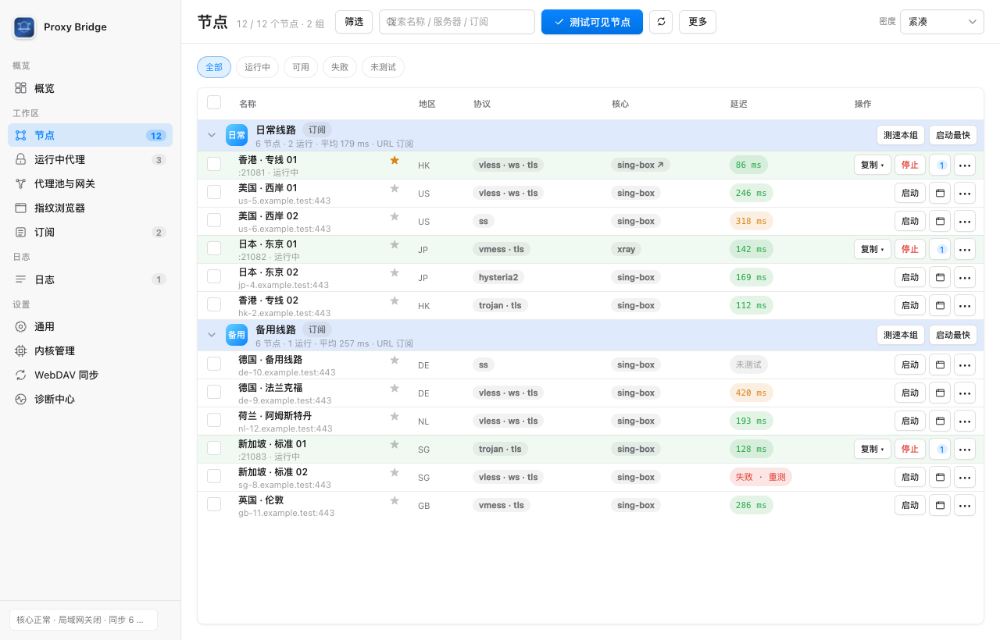
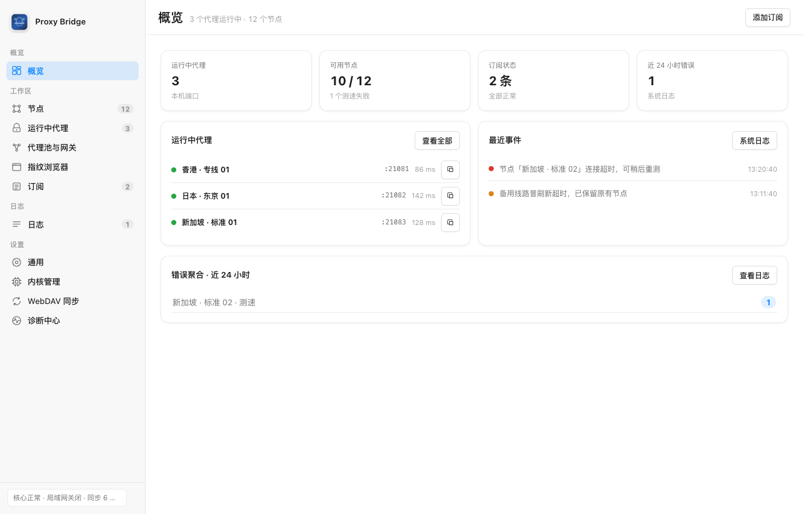
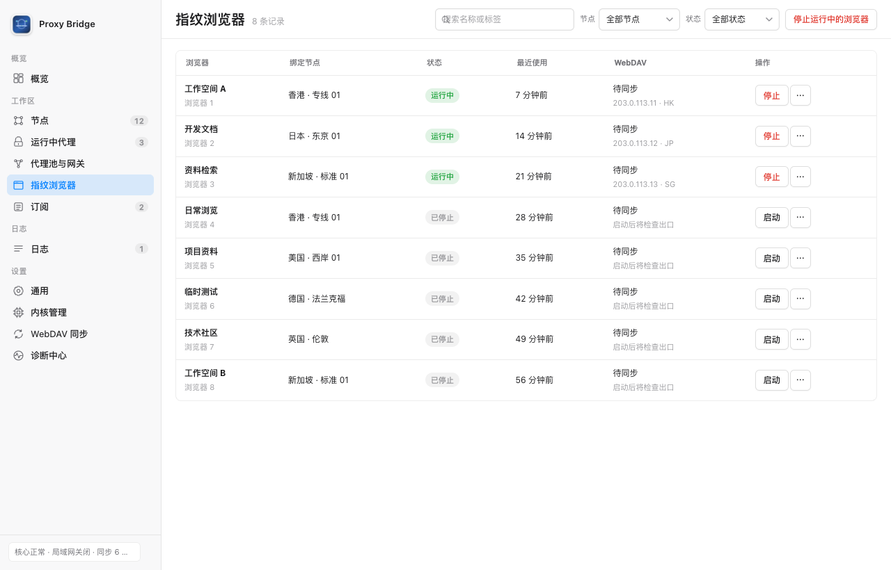

# Proxy Bridge

把订阅中的代理节点变成独立的本地代理端口，并在一个控制台中管理节点、测速和指纹浏览器。
支持 macOS、Windows、Linux 和 Docker；使用前需自行准备订阅或节点配置。

[下载最新版本](https://github.com/nXiaoK/ProxyBridge/releases/latest) · [快速开始](#快速开始) · [详细文档](#文档)



*节点管理：按订阅分组，查看延迟，一键启动并复制代理地址。截图基于当前源码，节点与运行状态均为演示数据。*

## 主要功能

- **订阅与节点**：导入订阅 URL、分享链接或 Clash / Mihomo YAML，支持自动刷新、搜索筛选和批量测速。
- **独立代理端口**：每个节点使用独立端口，同一端口支持 SOCKS5、HTTP 和 HTTPS CONNECT，便于不同软件分别使用。
- **双代理核心**：支持 sing-box / xray，可选择核心及配置失败回退。
- **指纹浏览器**：独立指纹种子与 Profile，绑定对应节点代理；可按记录设置平台、品牌、时区语言（默认按出口 IP）、地理位置、多版本内核、扩展与启动网址，支持分组、批量配置、换绑节点、Cookie 导入导出与一键指纹检测；桌面运行本机浏览器，Docker Compose 提供远程浏览器。
- **代理池与网关**：按健康、延迟、轮询或随机策略选择节点；宿主机模式可使用固定入口的智能网关。
- **同步与排障**：WebDAV 同步订阅和浏览器 Profile，连接日志、流量统计及诊断中心帮助定位问题。

支持 VLESS、VMess、Shadowsocks / SS2022、Trojan、Hysteria2、TUIC、SOCKS5、NaiveProxy、AnyTLS；具体可用性取决于所选核心。

<details>
<summary>查看更多界面：概览与指纹浏览器</summary>



*概览集中展示运行状态与最近事件，便于快速发现问题。演示数据。*



*指纹浏览器集中管理独立 Profile，查看绑定节点与运行状态。演示数据。*

</details>

## 快速开始

### 选择运行方式

| 方式 | 运行要求与入口 |
|---|---|
| macOS 菜单栏 App | Apple Silicon、macOS 13+；下载 Release 中的 `ProxyBridge-macOS-arm64-*.zip` |
| Windows 便携版 | Windows 10/11 x64；下载 Release 中的 `ProxyBridge-Windows-x64-*.exe`，双击启动 |
| 完整版（免下载内核） | 文件名含 `full` 的 macOS zip / Windows zip，额外内置 sing-box、Xray 与指纹浏览器内核，首次启动自动安装，适合无法访问 GitHub 的环境 |
| 源码运行 | macOS / Windows / Linux、Python 3.10+；见下方命令，前端无需构建 |
| Linux 托盘 | 需要桌面环境和托盘依赖，见 [安装教程](docs/windows-linux-install.md#3-linux-安装与使用) |
| Docker / NAS | Docker Engine API 1.45+（通常为 Engine 26+）、Compose v2，见 [部署教程](docs/docker.md) |

首次启动会下载代理核心；无法访问 GitHub 时，可改用完整版，或在 **设置 → 内核管理 → 本地导入** 安装官方发布包。轻量版的指纹浏览器内核需单独安装。macOS App 首次启动还会下载独立 Python 运行时。

macOS 发布版使用 ad-hoc 签名且未公证，Windows 发布版未签名。首次启动提示的处理方式见 [macOS 说明](docs/reference.md#重新构建-app) / [Windows 说明](docs/windows-linux-install.md#25-windows-常见问题)。

Docker 远程浏览器当前使用 `linux/amd64` worker，ARM 主机需要仿真；默认 Compose 不启用智能网关。部署前请阅读 Docker 文档中的端口、数据卷及 Docker Socket 权限说明。

### 从源码启动

```bash
git clone https://github.com/nXiaoK/ProxyBridge.git
cd ProxyBridge
# 安装订阅解析依赖，支持 Clash / Mihomo YAML
python3 -m pip install -r docker/requirements.txt
# 启动本机控制台，并打开带临时令牌的访问地址
python3 app.py --open
```

Windows 可将 `python3` 替换为 `python`。不自动打开浏览器时，请使用终端打印的完整 `http://127.0.0.1:8787/#token=...` 地址。

### 第一次使用

1. 在 **订阅** 页添加订阅 URL 或粘贴节点内容。
2. 在 **节点** 页筛选并测速，启动需要的节点。
3. 复制 SOCKS5 / HTTP 代理地址，填入支持代理的软件；也可从节点操作中启动指纹浏览器。
4. 在 **运行中代理** 查看流量和停止代理，在 **指纹浏览器** 管理浏览器记录。

控制台与代理默认仅本机可用。按需开启局域网代理共享时，请配置认证与 IP/CIDR 白名单；该开关不会开放管理控制台。订阅、控制台令牌、代理池链接和浏览器 Profile 均含敏感信息，请勿公开。

## 文档

- [使用与构建参考](docs/reference.md)：macOS、内核导入、启动参数、局域网、WebDAV、代理池与数据目录
- [Windows / Linux 安装教程](docs/windows-linux-install.md)：安装、托盘、自启、卸载与常见问题
- [Docker 部署教程](docs/docker.md)：Compose、远程浏览器、离线安装与安全边界
- [控制台使用说明](docs/console-workspace.md)：页面操作、配置与升级兼容
- [开发文档](doc/development-guide.md)：架构、API、测试、构建与扩展
