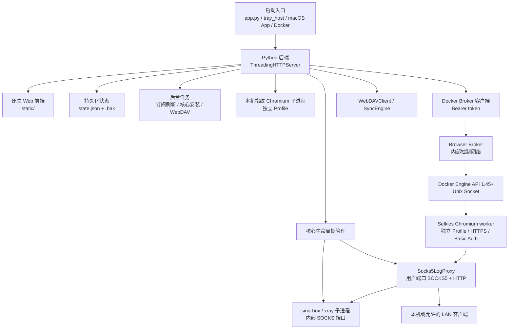

# ProxyBridge 开发文档

本文面向准备阅读、调试、修改或发布 ProxyBridge 的开发者。内容以当前仓库实现为准，重点说明代码结构、运行时架构、状态与并发约束、HTTP API、前端数据流、核心功能实现、测试体系和扩展方法。

安装与日常使用请优先阅读：

- [`README.md`](../README.md)
- [`docs/windows-linux-install.md`](../docs/windows-linux-install.md)
- [`docs/docker.md`](../docs/docker.md)

历史设计与稳定性约束可参考：

- [`docs/superpowers/specs/2026-07-10-lifecycle-resource-ownership-design.md`](../docs/superpowers/specs/2026-07-10-lifecycle-resource-ownership-design.md)
- [`docs/superpowers/specs/2026-07-10-project-wide-stability-review-design.md`](../docs/superpowers/specs/2026-07-10-project-wide-stability-review-design.md)
- [`docs/superpowers/specs/2026-07-12-proxy-pool-design.md`](../docs/superpowers/specs/2026-07-12-proxy-pool-design.md)

## 1. 项目定位

ProxyBridge 将订阅中的远程代理节点转换为本机可使用的 SOCKS5 与 HTTP/HTTPS CONNECT 代理端口，并提供：

- 订阅导入、解析、手动刷新和周期刷新。
- `sing-box` / `xray` 双核心选择、记忆与启动失败回退。
- 单节点测速与有界并发批量测速。
- 本地代理连接日志、流量统计和日志中心。
- LAN 认证、CIDR 白名单、连接上限和客户端管理。
- 智能代理池、健康评分、熔断、自动恢复和临时排除。
- 指纹 Chromium 的独立 Profile 管理。
- WebDAV 状态及浏览器 Profile 同步。
- 本地与网络诊断中心。
- macOS 菜单栏、Windows/Linux 托盘、无壳 Web 控制台和 Docker 四类运行形态。

项目刻意保持轻量：后端主要使用 Python 标准库，Web 控制台使用原生 HTML/CSS/JavaScript，没有 Web 框架、前端打包器或数据库服务。

## 2. 总体架构



### 2.1 核心分层

1. **控制层**：`app.py` 提供 HTTP API、状态管理、订阅解析、核心下载、生命周期控制和诊断。
2. **代理核心层**：每个运行节点由 `sing-box` 或 `xray` 子进程承载远端协议连接。
3. **外层代理层**：`Socks5LogProxy` 监听用户可见端口，同时处理 SOCKS5、HTTP 普通请求和 HTTPS CONNECT，再转发到核心内部端口。
4. **前端层**：`static/` 直接由后端提供，使用管理令牌调用 API。
5. **同步层**：`webdav_sync.py` 独立处理同步设置、快照、Profile 归档、加密和远端原子发布。
6. **桌面壳层**：`desktop/` 和 `macos/` 负责进程托管、菜单栏/托盘、自动打开控制台和开机自启，不重复实现后端业务。
7. **Docker 浏览器层**：`remote_browser.py` 只负责调用内部 Broker；`browser_broker.py` 独占 Docker Socket，为每个实例创建/销毁隔离 worker，不把 Docker Engine 权限交给主 Web 服务。

### 2.2 请求链路

启动一个节点时，典型链路为：

```text
Web 前端
  -> POST /api/bridges/start
  -> start_bridge()
  -> 校验节点与核心兼容性
  -> 分配用户端口和核心内部端口
  -> 生成 runtime/{bridge_id}.json
  -> 启动 sing-box/xray
  -> 等待核心内部端口就绪
  -> 启动 Socks5LogProxy 外层监听
  -> 更新 state.json
  -> /api/status 返回 running Bridge
```

客户端连接用户端口后：

```text
客户端 -> Socks5LogProxy -> 核心内部 SOCKS -> 远程节点 -> 目标网站
             |                    |
             +-- 认证 / ACL       +-- sing-box 或 xray
             +-- 客户端列表
             +-- 连接日志
             +-- 流量统计
```

## 3. 仓库目录

| 路径 | 作用 |
|---|---|
| `app.py` | 主后端、协议解析、HTTP API、核心与代理生命周期、浏览器、日志、诊断 |
| `remote_browser.py` | 主服务到内部 Browser Broker 的带 Bearer token 客户端 |
| `browser_fingerprint.py` | 浏览器记录的指纹配置校验、启动参数拼接、时区语言选择、Cookie 格式转换、CRX 解析与仅连 127.0.0.1 的 CDP WebSocket 客户端（纯逻辑，不读写状态） |
| `browser_broker.py` | Docker Engine 客户端、远程浏览器 worker 创建/查询/销毁与端口分配 |
| `webdav_sync.py` | WebDAV 客户端、同步引擎、Profile 打包、校验、加密和 LWW 应用 |
| `static/index.html` | Web 控制台页面结构与所有视图 |
| `static/app.js` | 前端状态、API 调用、渲染、事件和业务交互 |
| `static/auth.js` | URL fragment 管理令牌的读取、清除、会话保存和响应校验 |
| `static/diagnostics.js` | WebRTC ICE 候选采集和地址风险分类 |
| `static/styles.css` | 主题、布局、组件、响应式和可访问性样式 |
| `desktop/tray_host.py` | Windows/Linux 托盘壳、后端进程托管、单实例、日志和自启 |
| `desktop/autostart.py` | Windows、Linux、macOS 托盘自启实现 |
| `macos/ProxyBridgeMenuBar/` | 原生 macOS 菜单栏 App、Info.plist 和图标 |
| `scripts/` | 启动脚本、平台构建、图标生成和 macOS 原子替换工具 |
| `Dockerfile` / `compose.yaml` | 容器镜像和默认部署拓扑 |
| `docker/Dockerfile.broker` | 最小 Browser Broker 镜像 |
| `docker/requirements.txt` | Docker Python 依赖 |
| `tests/` | Python 与 Node 回归测试 |
| `docs/` | 安装、部署和历史设计文档 |
| `doc/` | 面向开发者的当前实现文档 |
| `work/` | 源码运行时默认数据目录，不应提交 |
| `outputs/` | 构建产物目录，不应提交 |

## 4. 运行模式

| 模式 | 入口 | 默认数据目录 | 浏览器能力 | 说明 |
|---|---|---|---|---|
| 无壳 Web | `python3 app.py` | 仓库 `work/` | 开启 | 最适合开发和后端调试 |
| Windows/Linux 托盘 | `python3 -m desktop.tray_host` | 平台用户数据目录 | 开启 | 托盘托管同一 `app.py` 后端 |
| macOS 菜单栏 | 构建后的 `.app` | `~/Library/Application Support/ProxyBridge` | 开启 | Swift 壳负责运行时下载和内嵌 WebView/菜单 |
| Docker Compose | `docker compose up` | `/data` | 远程 worker | 每实例独立 HTTPS worker；已停止 Profile 可同步 |
| 单容器 Docker | `docker run` | `/data` | 关闭 | 未配置 Broker 时保持旧版安全行为，只同步订阅/节点 |

### 4.1 功能开关

后端通过运行环境产生 `features` 和 `runtime` 状态，前端必须以服务端返回值为准，而不是仅依赖操作系统判断。

- `PROXY_BRIDGE_DOCKER=1`：进入 Docker 模式。
- `PROXY_BRIDGE_DISABLE_BROWSER=1`：关闭浏览器与 Profile 同步能力。
- `PROXY_BRIDGE_SHELL_MODE`：标识 `headless`、`tray` 等外壳模式。
- Docker 模式会强制使用容器代理端口范围；只有同时配置内部 `PROXY_BRIDGE_BROWSER_BROKER_URL` 且未显式禁用浏览器时，才启用远程浏览器及 Profile 同步。

## 5. 后端启动与关闭

### 5.1 `main()` 启动顺序

`app.py` 的 `main()` 是无壳后端入口，主要步骤如下：

1. 解析 `--port`、`--host`、`--workdir`、`--open` 和核心自动安装选项。
2. 重新绑定 `WORK_ROOT`、`RUNTIME_ROOT`、`STATE_PATH`。
3. 创建数据目录并设置敏感目录/文件权限。
4. 注册 `SIGINT`、`SIGTERM` 和 `atexit` 清理。
5. 如果存在 `PROXY_BRIDGE_PARENT_PID`，启动父进程监控。
6. 启动订阅自动刷新调度线程。
7. 按配置启动核心自动安装线程。
8. 从 `state.json` 恢复应继续运行的 Bridge。
9. 创建 `ProxyBridgeHTTPServer` 并进入 `serve_forever()`。

`ProxyBridgeHTTPServer` 继承 `ThreadingHTTPServer`，每个 HTTP 请求可在独立线程中处理；后台线程均应为 daemon，避免阻止进程退出。

### 5.2 关闭原则

关闭逻辑不是简单地清空状态表。必须遵守：

- 先停止接受新连接，再排空或关闭已有代理客户端。
- 代理处理线程退出后，流量计数才稳定，随后才能持久化最终流量。
- 核心或浏览器进程确认终止后，才能从运行时表移除句柄。
- 终止失败时保留句柄和所有权，允许下一次停止或 shutdown 重试。
- shutdown 使用单飞信号和 `SHUTDOWN_LOCK`，避免递归信号或并发 API 重复执行清理。

## 6. 并发、锁和资源所有权

### 6.1 主要锁

| 锁/同步对象 | 保护范围 |
|---|---|
| `STATE_LOCK` | `state.json` 对应的内存读取、规范化和保存 |
| `PROCESS_LOCK` | 核心、日志代理、浏览器等运行时句柄表 |
| `SHUTDOWN_LOCK` | 启动/停止与全局关闭生命周期屏障 |
| `BRIDGE_START_LOCK` | Bridge 启动单飞、端口和重复节点竞争 |
| `BROWSER_LAUNCH_LOCK` | 浏览器实例启动单飞 |
| `CORE_INSTALL_LOCK` | 核心下载安装单飞 |
| `FINGERPRINT_INSTALL_LOCK` | 指纹 Chromium 安装单飞 |
| `SUBSCRIPTION_LOCK` | 订阅导入、刷新、删除的串行一致性 |
| `LOG_ROTATION_LOCK` | 日志轮转和磁盘配额清理 |
| `SPEED_TEST_TASK_LOCK` | 批量测速任务表和取消事件 |
| `PROXY_CLIENT_LOCK` | 活动 LAN/本地代理客户端列表 |
| `TRAFFIC_LOCK` | Bridge 最终流量暂存和持久化协调 |
| `REQUEST_LOG_PENDING_LOCK` | 待写入连接日志批次 |
| `SYSTEM_LOG_LOCK` | 内存系统日志列表 |
| `POOL_RR_LOCK` | 代理池 round-robin 游标 |
| `SPEED_TEST_TARGET_LOCK` | 探测目标轮换游标 |
| `SUBSCRIPTION_SCHEDULER_LOCK` | 订阅调度线程启动状态 |
| `DIAGNOSTIC_RUN_SEMAPHORE` | 限制同时运行的诊断任务数量 |
| `SyncEngine._operation_lock` | WebDAV push/pull/check 串行化 |

上表覆盖跨功能开发最常遇到的同步对象；具体组件还可能有自己的实例锁、客户端锁和取消事件，修改前应搜索目标字段的全部读写位置。

### 6.2 所有权规则

修改生命周期代码时必须遵守以下不变量：

1. 资源登记既是查询索引，也是后续清理责任凭证。
2. 只有确认资源终止后才撤销登记。
3. 条件删除必须同时校验键和对象身份，防止删除并发替换后的新对象。
4. Bridge 所有权从核心子进程成功创建时开始，而不是从状态保存成功时开始。
5. 任一步启动失败都复用统一清理路径；清理失败必须保持可见。
6. 不要在 `STATE_LOCK` 内执行网络请求、长时间端口等待、进程等待或客户端排空。
7. 不要为了读取状态而反向获取生命周期锁，避免锁序反转。

### 6.3 新并发功能的建议模式

- 用一个短临界区登记任务和取消事件。
- 在线程启动前将任务写入表，避免前端轮询看不到任务。
- 耗时工作在锁外执行。
- 每个阶段检查取消事件和 `SHUTTING_DOWN`。
- finally 中只删除当前任务对象，避免误删同 ID 替代项。
- 将最终结果在 `STATE_LOCK` 下合并保存，不覆盖并发写入的无关字段。

## 7. 状态与数据模型

### 7.1 文件位置

默认源码模式：

```text
work/
  state.json
  state.json.bak
  runtime/
    {bridge_id}.json
    {bridge_id}.log
  browser_profiles/
    {node_stable_id}/{instance_id}/      # Profile；内含 ProxyBridgeExtensions/<扩展 ID>/ 扩展副本
  browser_extensions/
    google_search/                       # 内置默认搜索扩展
    library/{extension_id}/              # 上传的扩展库，含 .proxybridge-extension.json
  proxy-cores/
  fingerprint-chromium/
    versions/{kernel_id}/                # 多版本内核，含 .proxybridge-kernel.json
    .proxybridge-default-kernel.json     # 本机默认内核 {"id": "..."}，空 ID 表示最新版本
```

实际根目录由 `PROXY_BRIDGE_WORKDIR` 或 `--workdir` 决定。

### 7.2 `state.json` 顶层结构

`empty_state()` 定义最小基础结构。下面是用于理解的示意，字段会通过加载规范化函数补齐：

```json
{
  "subscriptions": [],
  "nodes": [],
  "bridges": [],
  "browser_instances": [],
  "tests": {},
  "request_logs": [],
  "settings": {
    "allow_lan": false,
    "lan_security": {},
    "subscriptions": {
      "allow_non_public_urls": false
    },
    "speed_test": {},
    "logs": {}
  }
}
```

`settings.webdav` 和 `settings.pool_token` 不属于 `empty_state()` 的最小字面值：WebDAV 同步引擎和 `ensure_pool_token()` 会在加载/使用相关功能时惰性注入并规范化它们。开发者仍应把这些字段视为持久化 schema 的一部分，但不能假设旧状态文件一定已经包含它们。

### 7.3 Node

`Node` dataclass 是解析结果的内部标准模型，关键字段包括：

| 字段 | 说明 |
|---|---|
| `id` | 节点稳定标识，用于关联 Bridge、测速和浏览器 |
| `name` | 展示名称 |
| `protocol` | `vless`、`vmess`、`shadowsocks`、`trojan`、`hysteria2`、`tuic`、`socks`、`naive`、`anytls` 等 |
| `server` / `port` | 远端服务器 |
| `region` / `source` | 地区推断和订阅来源 |
| `raw` | 原始分享链接或来源片段 |
| `settings` | 协议专属参数，如 UUID、密码、TLS、Reality |
| `transport` / `security` | 传输层与安全层参数 |
| `preferred_core` | 节点首选核心 |
| `fallback_enabled` | 首选核心失败时是否尝试备用核心 |

协议解析应尽早归一化，后续配置生成函数不应重复猜测输入格式。

### 7.4 Subscription

订阅记录除名称、URL 和节点关联外，还承载自动刷新状态：

- `etag` / `last_modified`：条件请求缓存验证。
- `refresh_interval_minutes`：订阅级刷新周期。
- `next_refresh_at`：调度器下次运行时间。
- 连续失败计数、退避时间和最后错误。
- 最近刷新时间与节点 diff 摘要。
- `node_ids` / `node_count`：当前订阅拥有的节点集合。

刷新失败必须保留旧节点；只有完整拉取、解析和校验成功后才能替换订阅节点。

### 7.5 Bridge

Bridge 是一个节点到本地代理端口的运行记录，通常包含：

- `id`、`node_id`、`node_name`。
- 用户可见 `port` 和核心内部端口。
- `core`、`status`、启动/停止时间。
- 累计上行、下行和总流量。
- 核心启动失败或回退信息。
- 代理池健康状态与手动排除时间。

`state.json` 中的 Bridge 是可恢复记录，真实运行状态仍以进程表、外层代理表和端口检查为准。

### 7.6 测速结果

`tests` 以 `node_id` 为键，记录最近结果，例如：

- 是否成功、延迟、错误。
- 尝试次数、成功次数和成功率。
- `tested_at`。
- 使用的探测目标。

前端根据 `tested_at` 计算结果年龄与过期状态。批量任务本身属于运行时状态，不作为长期业务数据依赖。

### 7.7 浏览器记录

`browser_instances[]` 中每条记录除名称、标签、`node_id`、`fingerprint_seed`、`profile_path` 与运行状态外，还包含以下可编辑字段（由 `normalize_browser_instances()` 补齐兼容默认值）：

| 字段 | 说明 |
|---|---|
| `group` | 自由分组名，最长 40 字，用于筛选与批量操作 |
| `fingerprint` | 指纹参数对象：`platform`、`platform_version`、`brand`、`brand_version`、`hardware_concurrency`、`disable_spoofing`、`timezone_mode`、`timezone`、`language_mode`、`language`、`accept_language`、`geolocation`、`window_size`；取值见 `browser_fingerprint.py` |
| `kernel_version` | 固定的内核版本 ID，空字符串表示跟随默认版本 |
| `cdp_enabled` | 是否开放本机 CDP 调试端口（127.0.0.1 随机端口，默认关闭，仅本机模式） |
| `extensions` | 扩展库中的扩展 ID 列表 |
| `start_urls` | 每次启动打开的 http(s) 网址，最多 10 个 |

运行期字段 `cdp_port`、`cdp_ws_path`、`runtime_kernel`、`runtime_locale` 只在运行中有效，停止后清空，不参与 WebDAV 同步。

缺少 `fingerprint` 字段的记录来自升级前版本，规范化时补成 `legacy_fingerprint_config()`（与升级前的启动参数一致）；新建记录使用 `recommended_fingerprint_config(host_platform)`（Chrome 品牌、按出口 IP 匹配时区语言、默认禁止地理定位；macOS 上语言为 `system` 并关闭 Canvas 与字体伪装，原因是 macOS 版 Chromium 的 `Intl` 区域不受 `--lang` 影响，且这两项伪装会被 Pixelscan 判定为 masking）。`language_mode` 可取 `system`、`region`、`exit_ip`、`custom`，`system` 时不传 `--lang` / `--accept-lang`。修改默认值时必须保持这一区分，避免已登录账号的指纹在升级后变化。

订阅刷新或删除导致节点消失时，被浏览器记录引用的节点会带上 `_webdav_browser_preserved` 标记继续保留（公开字段为 `browser_preserved`），记录与 Profile 不删除；`prune_preserved_browser_nodes()` 在换绑或删除最后一条引用后清理这些节点。只有 `/api/subscriptions/delete` 显式传 `delete_browser_profiles: true` 时才连同记录与 Profile 删除。

### 7.8 原子保存与恢复

`save_state()` 使用临时文件、`fsync` 和原子替换，并维护 `state.json.bak`。`load_state()` 的原则是：

1. 主文件有效时加载并规范化。
2. 主文件损坏时尝试备份。
3. 备份恢复后明确记录错误。
4. 主文件与备份均不可用时拒绝以空状态静默覆盖。

新增字段必须在默认状态和规范化函数中提供兼容默认值，不能假设所有用户状态文件都来自最新版。

## 8. 订阅与协议解析

### 8.1 支持输入

解析入口支持：

- 单条或多条分享链接。
- Base64 包装的订阅文本。
- Clash/Mihomo YAML `proxies`。
- 订阅 URL 拉取结果。

主要协议包括 VLESS、VMess、Shadowsocks/SS2022、Trojan、Hysteria2、TUIC、SOCKS5、NaiveProxy 和 AnyTLS。

### 8.2 刷新流程

`refresh_subscription()` 的关键流程：

1. 在 `SUBSCRIPTION_LOCK` 下确认目标订阅。
2. 校验 URL、DNS 解析和重定向安全；默认阻止本机与私网地址，用户显式开启 `allow_non_public_urls` 后才允许 TUN fake-IP 或可信局域网地址。
3. 携带 `If-None-Match` / `If-Modified-Since`。
4. `304 Not Modified` 时只更新时间，不重建节点。
5. 下载响应受大小、超时和重定向次数限制。
6. 解析新节点，零节点或解析失败时保留旧状态。
7. 对比旧节点，生成新增、删除、修改 diff。
8. 停止被删除节点关联的运行时资源和浏览器记录。
9. 保存新节点、缓存头、刷新时间和下次调度时间。

### 8.3 自动刷新

`subscription_scheduler_loop()` 使用 daemon 线程，周期唤醒并选择到期订阅：

- 刷新周期允许范围为 5 分钟到 7 天。
- 失败使用指数退避，上限 24 小时。
- 调度器每次只处理应运行项，不为每个订阅长期占用线程。
- 用户更新刷新周期后通过 wake event 提前唤醒调度器。

### 8.4 新增协议

新增协议通常需要同时完成：

1. 在解析分发中识别 scheme 或 YAML `type`。
2. 输出标准 `Node`，不要把解析逻辑留给启动阶段。
3. 明确 `sing-box`、`xray` 或双核心兼容性。
4. 为每个支持核心增加配置生成分支。
5. 更新前端协议筛选和展示标签。
6. 在 `tests/test_parser.py` 增加分享链接、YAML 和配置生成测试。
7. 如存在核心差异，在 `tests/test_core_selection_and_fallback.py` 增加覆盖。

## 9. 核心选择与 Bridge 生命周期

### 9.1 核心发现

核心路径按以下来源解析：

1. `PROXY_BRIDGE_SING_BOX` / `PROXY_BRIDGE_XRAY` 显式路径。
2. `PROXY_BRIDGE_CORE_DIR` 指定目录。
3. 工作目录自动安装位置。
4. App 内置资源或系统可执行路径。

核心缺失时，普通模式可通过后台线程从 GitHub Releases 下载并事务性安装。控制台也可调用 `POST /api/cores/upload` 本地导入官方包：请求正文是 `application/octet-stream` 原始文件，后端验证官方文件名中的 OS/架构标记，以 1 MiB 分块写入工作目录的 `0700` 私有暂存目录，并在安装前核对长度、可选 SHA-256 和可执行文件的 `version` 输出。单文件上限 2 GiB，解压后上限 4 GiB、成员上限 100,000；替换失败必须保留上一份可执行文件。

上传和在线下载复用 `_install_core_from_archive()`、`_install_fingerprint_package()`、安全解压及原子替换逻辑。上传代理核心前必须没有使用目标核心的活动 Bridge；上传指纹内核前必须没有活动浏览器实例。Docker 远程模式只接受 Linux x86_64 指纹包，并在替换前要求与 `chrome` 同目录存在可执行 `chrome-wrapper`。

### 9.2 启动顺序

`start_bridge()` 的主要职责：

1. 在生命周期屏障内拒绝 shutdown 后的新启动。
2. 校验节点是否存在、核心是否兼容、同节点是否已有活动所有权。
3. 计算核心尝试顺序：节点偏好、兼容性和 `fallback_enabled`。
4. 分配用户端口及核心内部端口。
5. 生成核心配置和运行日志路径。
6. 启动核心并立即登记进程及节点所有权。
7. 等待内部端口，不在 `STATE_LOCK` 内阻塞。
8. 创建外层 `Socks5LogProxy`。
9. 持久化 Bridge。
10. 首选核心失败且允许回退时，清理后尝试备用核心。

### 9.3 停止顺序

停止一个 Bridge 时：

1. 停止接受新的外层代理连接。
2. 关闭已跟踪客户端和上游套接字。
3. 等待处理线程排空。
4. 停止核心进程。
5. 对成功终止的对象执行身份校验后删除运行时登记。
6. 读取最终流量快照。
7. 更新 Bridge 状态并保存。

不得在代理线程仍可能写入流量时提前保存 `stopped` 状态。

## 10. 外层代理与 LAN 安全

### 10.1 `Socks5LogProxy`

外层代理在同一端口接受：

- SOCKS5 CONNECT。
- HTTP 绝对形式请求。
- HTTPS CONNECT 隧道。

它负责：

- 协议握手与请求解析。
- LAN 来源 ACL。
- SOCKS5 RFC 1929 用户名密码认证。
- HTTP Basic / Bearer 认证。
- 全局活动连接上限。
- 客户端和上游套接字跟踪。
- 半关闭、空闲超时和双向流量统计。
- 连接日志写入。

### 10.2 监听模式

- 默认监听 `127.0.0.1`。
- 开启 LAN 后监听 `0.0.0.0`。
- 默认 LAN 白名单为 RFC1918 IPv4 网段，并始终允许本机。
- 最多配置 32 条 IP/CIDR。
- 修改 LAN 设置会事务性重绑所有运行代理；任一步失败要回滚到旧监听模式。
- 管理控制台监听与代理监听是独立概念，开启 LAN 代理不应自动公开管理 API。

### 10.3 安全设置扩展

新增 LAN 设置字段时需要同步更新：

- 默认状态与规范化函数。
- 公共设置投影，确保密码/token 不回传原文。
- `update_network_settings()` 校验和回滚。
- SOCKS5 与 HTTP 两种认证路径。
- 设置页表单和脏状态保护。
- `tests/test_lan_settings.py` 与 `tests/test_lan_security_and_smart_pool.py`。

## 11. 测速系统

### 11.1 单节点测速

测速会临时启动或复用节点通路，通过 SOCKS5 请求探测目标，记录连接结果、延迟和成功率。探测目标由设置提供，默认内置多个固定 URL，可轮换使用。

关键限制：

- 目标数量有上限，必须是允许的 HTTP(S) URL。
- 测速进程和核心仍受全局生命周期所有权管理。
- shutdown 开始后不得再创建新的测速进程。
- 结果保存要与 shutdown 串行，避免退出时覆盖。

### 11.2 批量测速

批量任务具备：

- 3 到 5 路可配置有界并发。
- 单任务最多 500 个节点。
- 任务表最多保留有限数量的任务。
- 每项独立状态与结果。
- 取消事件。
- 失败项重试。
- 前端轮询 `/api/status` 或 `/api/speed-test/tasks` 更新进度。

不要为每个节点无界创建线程或核心进程。新增任务字段时，前后端都应容忍旧任务缺少该字段。

## 12. 智能代理池

### 12.1 成员来源

代理池不维护独立成员数据库，而是从 Bridge 派生：

- `running` 或 `starting`。
- 端口有效。
- 可按地区、关键词和就绪状态筛选。
- `/get` 默认只选择真实就绪的运行成员。

### 12.2 选择策略

`/pool/{token}/get` 支持：

- `random`：随机选择。
- `round_robin`：进程内轮询。
- `latency`：优先低延迟。
- `health`：综合 EWMA 延迟、测速成功率和连续失败。

### 12.3 熔断

当前实现以连续失败驱动熔断：

- 达到阈值后打开熔断器。
- 冷却时间按失败情况退避，并限制最大值。
- 冷却后进入 half-open，只允许一次探测。
- 成功反馈关闭熔断器，失败则重新打开。
- 用户可将单节点临时排除，最长 7 天。

池 token 存在 `settings.pool_token`，消费端只接受 loopback Host 和 path token。日志必须使用 `_redact_pool_token_in_log_arg()` 脱敏。

## 13. 日志中心

### 13.1 日志类别

| 类别 | 来源 | 主要内容 |
|---|---|---|
| 连接日志 | `Socks5LogProxy` | 客户端、目标、节点、协议、流量、耗时、结果 |
| 系统日志 | `log_event()` | API、核心、订阅、同步、设置和生命周期事件 |
| 核心日志 | 子进程 stdout/stderr pump | sing-box/xray 原始运行日志 |
| 托盘后端日志 | `desktop/tray_host.py` | 后端启动、就绪、重启和退出 |

### 13.2 查询与导出

日志 API 支持：

- 服务端分页和总数。
- 关键词、节点、状态或级别筛选。
- CSV / JSON 导出。
- CSV 单元格公式注入防护。
- 分别清空连接日志和系统日志。

### 13.3 轮转和配额

- 核心日志默认单文件上限 8 MiB，保留 3 份备份。
- 日志设置支持按日/大小轮转、保留天数和总磁盘配额。
- 轮转与清理必须在 `LOG_ROTATION_LOCK` 下完成。
- 删除文件时只能处理工作目录内已知日志，不接受任意用户路径。

## 14. 诊断中心

### 14.1 后端检查

`run_diagnostics()` 默认只执行本地检查：

- `sing-box` / `xray` 可执行性和版本。
- 控制台端口、活动代理端口和 Docker 发布范围。
- 工作目录、运行目录、状态文件权限及磁盘空间。

只有用户显式勾选网络检查后才执行：

- 固定 GitHub API 目标。
- 已配置的安全 WebDAV 目标。
- 经选定 SOCKS5 Bridge 访问固定 `api.ipify.org`。
- 远端 DNS 能力风险提示。

诊断同时运行数量由 `DIAGNOSTIC_RUN_SEMAPHORE` 限制为 2；单次内部检查使用小型线程池。不要把诊断改造成可请求任意 URL 的 SSRF 工具。

### 14.2 WebRTC

`static/diagnostics.js` 在浏览器侧执行：

- 使用 `RTCPeerConnection({ iceServers: [] })`。
- 不调用第三方 STUN。
- 解析 IPv4、IPv6 和 mDNS ICE 候选。
- 分类 loopback、private、public、link-local 等地址。
- 无候选时只报告“不确定/可能被隐藏”，不宣称没有泄漏。

前端使用 `Promise.allSettled()` 合并后端和 WebRTC 结果，单项失败不能覆盖其他成功结果。诊断结果不持久化。

## 15. WebDAV 同步

### 15.1 主要对象

- `WebDAVClient`：HTTP/WebDAV 方法、Basic Auth、TLS、重定向和响应大小限制。
- `SyncEngine`：设置、push、pull、check、自动上传和启动检查。
- `MemoryWebDAV`：测试用内存实现。

### 15.2 同步范围

- 桌面/普通无壳模式，以及已配置 Browser Broker 的 Docker Compose：订阅、节点、浏览器记录和已停止 Profile。
- 未配置 Broker 或显式禁用浏览器的模式：只同步订阅与节点，保留远端和本地浏览器数据。
- Docker Broker 不可达时不能据此判断 worker 已停止；对相关 Profile 必须 fail-closed，拒绝归档可能仍在运行的目录。

### 15.3 发布协议

push 使用不可变快照和原子 manifest：

```text
remote_root/
  manifest.json
  state-{sha16}-{snapshot_id}.sync.json
  state.sync.json
  profiles/{instance_id}-{sha16}-{snapshot_id}.tar.gz
  profiles/{instance_id}.tar.gz
```

流程：

1. 在 `_operation_lock` 下串行化操作。
2. 构建同步状态和 Profile 归档。
3. 计算 SHA-256。
4. 上传版本化对象。
5. 上传临时 manifest。
6. 使用 WebDAV `MOVE` 原子替换正式 manifest。
7. 最后更新兼容别名和清理孤儿对象。

pull 先验证 schema、对象大小和哈希，再应用远端 LWW 状态。校验失败时不得修改本地状态或 Profile。

### 15.4 安全要求

- Profile 解包必须拒绝路径穿越、链接、设备文件和超限归档。
- HTTPS 重定向必须同源，拒绝协议降级。
- `insecure_ssl` 必须是用户显式选择。
- URL userinfo 要迁移到独立凭据字段，并从公开 URL、日志和错误响应中删除。
- `Authorization`、密码和加密密码不得出现在公共设置。
- 在正式 manifest `MOVE` 前失败时，上一份远端 manifest 保持可读；`MOVE` 成功后，兼容别名更新或孤儿清理失败可能返回 `ok: false`，但新 manifest 已经发布。
- pull 会在应用本地状态前验证 schema、大小和哈希；验证失败时保留本地旧状态。
- 可选 PBENC2 使用 PBKDF2、AES-256-CBC 与 HMAC；仍兼容读取 PBENC1。

## 16. 浏览器与 Profile

### 16.1 浏览器发现

浏览器路径来源包括：

- `PROXY_BRIDGE_FP_CHROMIUM`。
- 工作目录自动安装的 fingerprint-chromium。
- App 内置资源。
- 普通 Chrome 路径用于兼容场景。

Docker 远程模式只接受 `proxybridge-data` 命名卷中 `/data/fingerprint-chromium/` 下的 Linux 内核完整目录，并要求存在可执行的 `chrome-wrapper`。Broker 要求 Docker Engine API 1.45+，使用 `VolumeOptions.Subpath` 将该命名卷子目录只读挂载到 worker 的 `/opt/fingerprint-chromium`，再通过容器初始化脚本安装 `/usr/bin/chromium` 启动器；启动器直接执行真实 wrapper 路径，避免符号链接改变其相邻资源定位。远程模式不接受 `/data` 的宿主机 bind mount。当前 Linux 指纹包为 x86_64，镜像拉取、检查和 worker 创建均固定 `platform=linux/amd64`；arm64 宿主机依赖 Docker 仿真，性能与 GPU 能力不作为原生支持保证。

### 16.2 实例模型

每个浏览器实例关联：

- `id`、`node_id`、名称和标签。
- 独立 Profile 目录。
- `running` / `starting` / `stopping` / `stopped` / `failed` 状态。
- 可恢复的启动次数，以及创建、启动、停止和 `last_used_at` 时间；状态 API 与前端按最近使用时间倒序投影。
- Docker 记录还包含 `remote_worker`、`remote_url`、worker 容器 ID、宿主端口和用户名；新记录继续使用与桌面浏览器一致的 `native-v1` Profile 布局，旧版嵌套 Profile 目录只作为兼容布局读取。密码绝不能写入记录或状态 API。

同一节点可存在多个历史记录，但运行时表必须阻止同一实例重复启动。

### 16.3 启动与停止

本机浏览器启动时：

1. 确保关联 Bridge 已运行。
2. 确保指纹内核存在。
3. 根据节点 ID 派生稳定指纹、语言和时区。
4. 创建独立 Profile 并登记进程句柄。
5. 状态保存失败时尝试终止；终止失败则保留句柄。

Docker 远程浏览器启动时：

1. 前端凭据弹窗默认用户名 `proxybridge`，并用 Web Crypto 生成可复制、可修改的随机强密码；密码仅随本次启动请求发送。
2. 后端确保关联 Bridge 已运行，创建独立 Profile，并派生该实例固定的指纹种子、语言和时区。
3. Broker 校验 Profile/内核相对路径和 `/data` 命名卷来源，选择 `23000-23099` 中的空闲端口，为密码创建临时只读 secret，并创建一个非特权 `linux/amd64` worker。
4. worker 的 `/config` 是随容器删除的匿名卷；只有当前 Profile 通过命名卷 `volume-subpath` 读写挂到 `/config/browser-profile`，指纹内核子目录只读挂到 `/opt/fingerprint-chromium`。Selkies TLS、认证与 nginx 运行文件不会进入 Profile 或 WebDAV 快照。
5. worker 使用该节点的内部 SOCKS5 端口；主服务查询 Broker 会话，只对“精确 worker IP + 分配给该实例的代理端口”组合免除代理二次认证，不按整个 worker CIDR 放行。
6. LinuxServer Selkies 在匿名 `/config` 中动态生成自签名 HTTPS，并通过 `CUSTOM_USER` / `FILE__PASSWORD` 开启 Basic Auth。Broker 等到容器运行、`3001` 端口可连接且 Docker health 为 `healthy` 后才返回。
7. Broker 返回 `remote_url` 后，前端打开链接；运行记录提供再次打开、查看凭证与停止入口，并显示用户名、URL、端口和 worker 状态。

停止本机浏览器时，只有进程确认退出后才能从实例表和节点表删除句柄。停止远程实例采用 generation 失效与两阶段提交：先在锁内标记 `stopping`，再在锁外请求 Broker 停止，防止并发启动结果把实例恢复为 `running`。Broker 停止并删除 worker、匿名 `/config` 运行卷和临时 secret，但保留 Profile 与稳定指纹种子；下次启动必须设置新密码。任何运行中的 Profile 都不允许参与 WebDAV 上传。Broker 启动时会回收上次异常退出遗留的带所有权标签 worker，Compose 为主服务和 Broker 都配置 3 分钟 `stop_grace_period`，用于完成并行回收与 Profile 落盘。

查看凭证只适用于 `running` 的远程实例：认证后的主服务 API 在状态锁外调用 Broker，Broker 重新校验 worker 所有权标签，从容器 `CUSTOM_USER` 与私有运行期 secret 读取凭证。密码响应使用 `Cache-Control: no-store`，前端关闭查看窗口立即清空字段，且复制流程不得调用会把密码回传服务端的 `/api/clipboard`。

单条删除在所有平台使用两阶段流程：先在 `BROWSER_LAUNCH_LOCK` 下停止本机进程或远程 worker，再由经过校验的节点/实例 ID 重建 Profile 路径并物理删除，最后移除状态记录。不能信任状态中的绝对 `profile_path`；legacy 节点级 Profile 删除还必须保留同节点其他实例子目录。成功后标记本地同步变更并排队 WebDAV 全量 push，使远端 state 与孤立 Profile 包同步删除。

### 16.4 Docker 远程访问安全边界

- Broker token 只通过私有命名卷在主服务与 Broker 间共享；Broker HTTP 端口只存在于 `browser-control` internal 网络。
- Profile 和指纹内核只能来自 `/data` 对应的 Docker 命名卷，通过 Engine API 1.45+ 的 `volume-subpath` 挂载；远程模式拒绝宿主机 bind mount，避免主服务数据目录中的符号链接扩大为任意宿主路径挂载。
- worker 网络仅提供隔离与寻址，不是认证边界。代理免认证每次都以 Broker 当前返回的 worker RFC1918 IP 和该实例代理端口精确匹配；inspect/sessions 失败时 fail-closed。
- Browser worker 的自签名 HTTPS 加 Basic Auth 只适合可信 LAN/VPN。公网入口必须使用受信任证书的 TLS 反向代理，并叠加 SSO/MFA 或等效强认证；不得直接发布动态 worker 端口。
- `PROXY_BRIDGE_BROWSER_HOST` 与 `PROXY_BRIDGE_BROWSER_PUBLIC_HOST` 只接受回环、RFC1918 或 Tailscale `100.64.0.0/10` IPv4，拒绝 `0.0.0.0`、主机名和公网地址。
- Docker Socket 的 `:ro` 不限制 Docker API 的写操作。持有该 Socket 的 Broker 仍能创建/删除容器和挂载宿主机路径，应视为宿主机级高权限组件，不能部署到不可信多租户 daemon。

## 17. HTTP API

### 17.1 管理认证

启动时后端生成或读取 `PROXY_BRIDGE_INSTANCE_TOKEN`，并打印：

```text
http://127.0.0.1:8787/#token=...
```

前端流程：

1. `static/auth.js` 从 fragment 读取 token。
2. 立即清除地址栏 fragment。
3. 优先保存在当前标签页的 `sessionStorage`；不可用时降级到该标签页的 `history.state`。
4. 每个管理请求发送 `X-ProxyBridge-Instance`。
5. 后端对可信 Host、Origin、`Sec-Fetch-Site` 和 token 做联合校验。
6. 前端校验响应头中的实例 token，失配时清空会话。

除 Docker 健康检查使用的 `HEAD /api/status` 外，管理 API 均需要认证。不要把 token 放入 query、持久化日志或仓库文件。

### 17.2 GET 路由

| 路由 | 作用 |
|---|---|
| `GET /api/status` | 主状态快照：功能、核心、订阅、节点、Bridge、测速、日志摘要、设置和同步 |
| `GET /api/pool` | 控制台代理池视图和链接 |
| `GET /api/network/clients` | 当前代理客户端列表 |
| `GET /api/sync/status` | WebDAV 公共设置和 OpenSSL 能力 |
| `GET /api/speed-test/tasks` | 批量测速任务 |
| `GET /api/logs` | 连接/系统日志分页查询 |
| `GET /api/logs/export` | CSV/JSON 导出 |
| `GET /api/core/logs` | 活动核心日志列表或内容 |
| `GET /api/system/logs` | 系统日志兼容入口 |
| `GET /api/log/{id}` | 单个 Bridge 核心日志 |

### 17.3 POST 路由

| 分组 | 路由 |
|---|---|
| 订阅 | `/api/subscriptions/import`、`refresh`、`schedule`、`delete` |
| Bridge | `/api/bridges/start`、`stop`、`stop-all` |
| 测速 | `/api/nodes/test`、`/api/nodes/test-batch/start`、`cancel` |
| 核心偏好 | `/api/nodes/core` |
| 内核安装 | `/api/cores/upload`（`application/octet-stream`，不是 JSON） |
| 设置 | `/api/settings/subscriptions`、`speed-test`、`logs`、`network` |
| 诊断 | `/api/diagnostics/run` |
| 浏览器 | `/api/browser/launch`、`stop`、`delete`、`credentials`、`update`（单条 `instance_id` 或批量 `instance_ids`）、`create`、`rebind`、`regenerate-fingerprint`、`open-url`、`cookies/export`、`cookies/import`、`extensions/delete`、`download-kernel`（可选 `tag` / `latest`） |
| 浏览器扩展 | `/api/browser/extensions/upload`（`application/octet-stream`，文件名放在 `X-ProxyBridge-Upload-Name`，上限 64 MiB） |
| 窗口助手回调 | `/api/browser/window-closed`（仅 macOS 本机浏览器内的窗口助手扩展调用；正文为启动时下发的一次性令牌，不检查来源、不需要管理令牌，始终返回 204） |
| 指纹内核版本 | `/api/browser/kernels/releases`、`default`、`delete` |
| 日志 | `/api/logs/clear`、`/api/system/logs/clear` |
| 代理池 | `/api/pool/token/rotate`、`feedback`、`exclude` |
| 客户端 | `/api/network/clients/kick` |
| WebDAV | `/api/sync/settings`、`test`、`push`、`pull`、`check` |
| 其他 | `/api/clipboard` |

### 17.4 代理池消费端

| 路由 | 说明 |
|---|---|
| `/pool/{token}/list.json` | JSON 成员列表 |
| `/pool/{token}/proxies.txt` | 文本代理地址 |
| `/pool/{token}/get` | 按策略选择一个成员 |

消费端路由使用 loopback Host + path token，不要求控制台 Origin，也不会将正常空池轮询写成系统错误日志。

### 17.5 新增 API 的规范

1. 业务逻辑先写成可直接测试的函数，不把全部逻辑塞进 `AppHandler`。
2. 在 `do_GET()` 或 `do_POST()` 中添加明确路由。
3. 管理接口复用 `require_api_authentication()`。
4. 普通输入体受 JSON 大小限制，字段必须显式校验类型和范围。大文件上传必须使用独立固定路由、原始二进制流、准确 `Content-Length`、分块落盘和单独大小限制，不能 Base64/JSON 化。
5. 成功响应使用 `json_response()`，下载使用 `download_response()`。
6. 错误走 `error_response()`，但敏感信息必须在进入错误通道前脱敏。
7. 长操作不要持有 `STATE_LOCK`。
8. 同步更新前端 API 调用和回归测试。

## 18. 前端架构

### 18.1 文件职责

- `index.html`：侧边栏、各 view、表单、模态框、ARIA 结构。
- `app.js`：全局状态、数据加载、渲染、事件、API 业务流。
- `auth.js`：管理令牌会话。
- `diagnostics.js`：纯函数化的 WebRTC 诊断，可在 Node 中测试。
- `core-upload.js`：内核文件、SHA-256 与请求头校验，使用原始 `File` 正文上传并验证响应实例令牌。
- `styles.css`：主题、布局、组件、移动端断点和 focus 样式。

### 18.2 视图

`VIEW_IDS` 当前包含：

```text
nodes
subscriptions
bridges
logs
system
settings
sync
diagnostics
```

`setActiveView()`：

- 更新 `appState.activeView`。
- 写入 `localStorage` 的 `pb-view`。
- 设置 `aria-current`。
- 控制对应 `<section data-view>` 的 `hidden`。
- 触发当前视图的数据加载和渲染。

### 18.3 `appState`

`appState` 是前端唯一主要状态容器，包含：

- 平台、features、runtime、cores。
- subscriptions、nodes、bridges。
- tests、speedTest、pool。
- request/system logs、分页和筛选。
- network、sync、diagnostics。
- 浏览器实例和筛选/折叠状态。

不要从 DOM 反向推导业务状态。API 返回后先更新 `appState`，再渲染。

### 18.4 API helper

`api(path, body, { signal })` 统一处理：

- 管理 token header。
- GET/POST 与 JSON 编码。
- AbortSignal。
- 响应实例 token 校验。
- HTTP 非成功状态和 `payload.error`。

新增前端请求必须使用 `api()`，除日志文件下载和内核原始文件上传等确实需要原始响应/正文的路径。此类例外仍必须复用 `auth.js` 的请求 token 与响应实例 token 校验；内核上传封装在 `core-upload.js`，不能绕过认证直接调用 `fetch()`。

### 18.5 状态轮询和渲染

`loadStatus()`：

- 防止重复并发状态请求。
- 使用 AbortController 设置超时。
- 将 `/api/status` 分区写入 `appState`。
- 保留已单独分页加载的日志数据。
- 调用 `render()`。

`renderActiveView()` 按当前 view 分发，`renderWhenChanged()` 使用签名缓存减少无意义 DOM 重建。

设置表单必须维护 dirty 状态，避免周期状态轮询覆盖用户尚未保存的输入。WebDAV、LAN、测速和日志设置均采用此模式。

### 18.6 事件模型

事件主要集中在 `bindEvents()`：

- 固定表单和按钮直接绑定。
- 重复列表按钮使用 `data-action` + `handleAction()` 事件委托。
- 异步按钮进入 disabled / `is-busy` 状态。
- 成功后更新 `appState` 或调用 `loadStatus({ forceFresh: true })`。
- 错误通过 toast 展示。
- 页面隐藏时降低轮询频率；卸载时清理状态/筛选 timer，并取消当前状态请求。

### 18.7 安全、可访问性与响应式

- 所有动态 HTML 必须使用 `escapeHtml()`。
- 不要把 API 返回字符串直接拼入未转义 `innerHTML`。
- 模态框使用 `role="dialog"`，并维护焦点陷阱和 Escape 关闭。
- 状态区域使用 `aria-live`。
- 仅图标按钮需要 `aria-label` 或 tooltip。
- 新视图需在 720px 和 520px 断点验证布局。
- 文本不得依赖 viewport 宽度动态缩放。

### 18.8 新增前端视图

1. 在 `index.html` 增加 `.nav-item[data-view]`。
2. 增加对应 `<section class="view" data-view>` 和标题关联。
3. 将 ID 加入 `VIEW_IDS`。
4. 在 `appState` 增加默认值。
5. 实现 `renderX()`。
6. 在 `renderActiveView()` 增加分支。
7. 在 `bindEvents()` 或 `handleAction()` 连接交互。
8. 动态数据统一转义。
9. 添加 Node 可测试的纯函数时，优先拆到独立 UMD 模块。
10. 验证桌面和移动端无溢出、遮挡或陈旧状态。

## 19. 配置与环境变量

### 19.1 `app.py` CLI

常用参数：

| 参数 | 作用 |
|---|---|
| `--port` | Web 控制台端口 |
| `--host` | Web 控制台绑定地址 |
| `--workdir` | 数据和运行目录 |
| `--open` | 启动后打开认证控制台 URL |
| `--no-core-auto-install` | 禁止启动时自动下载安装核心 |

### 19.2 后端环境变量

| 环境变量 | 作用 |
|---|---|
| `PROXY_BRIDGE_WORKDIR` | 工作目录 |
| `PROXY_BRIDGE_HOST` | 控制台绑定地址 |
| `PROXY_BRIDGE_PORT` | 控制台端口 |
| `PROXY_BRIDGE_CONSOLE_HOST` | 对外生成/信任的控制台主机，Docker 常用 |
| `PROXY_BRIDGE_INSTANCE_TOKEN` | 自定义管理实例令牌 |
| `PROXY_BRIDGE_DOCKER` | Docker 模式 |
| `PROXY_BRIDGE_DISABLE_BROWSER` | 禁用浏览器功能 |
| `PROXY_BRIDGE_SHELL_MODE` | 外壳类型标识 |
| `PROXY_BRIDGE_PARENT_PID` | 托盘/菜单栏父进程 PID |
| `PROXY_BRIDGE_CORE_DIR` | 核心目录 |
| `PROXY_BRIDGE_SING_BOX` | sing-box 可执行路径 |
| `PROXY_BRIDGE_XRAY` | xray 可执行路径 |
| `PROXY_BRIDGE_CHROME` | 普通 Chrome 路径 |
| `PROXY_BRIDGE_FP_CHROMIUM` | 指纹 Chromium 路径 |
| `PROXY_BRIDGE_PROXY_PORT_START` | 用户代理端口起点 |
| `PROXY_BRIDGE_PROXY_PORT_END` | 用户代理端口终点 |
| `PROXY_BRIDGE_BROWSER_BROKER_URL` | 仅供 Docker 主服务访问的内部 Broker HTTP 地址；缺失时关闭远程浏览器 |
| `PROXY_BRIDGE_BROWSER_BROKER_TOKEN_FILE` | Broker 随机 Bearer token 的只读文件；不得放到公开目录 |
| `PROXY_BRIDGE_BROWSER_PROXY_HOST` | worker 连接 ProxyBridge 节点代理时使用的内部服务名，Compose 默认 `proxybridge` |

### 19.3 Browser Broker 与 Compose 部署环境变量

| 环境变量 | 作用与注意事项 |
|---|---|
| `PROXY_BRIDGE_BROWSER_HOST` | worker HTTPS 端口实际绑定的宿主机 IPv4；只允许回环、RFC1918 或 Tailscale `100.64.0.0/10` 地址，不能填 `0.0.0.0` |
| `PROXY_BRIDGE_BROWSER_PUBLIC_HOST` | 生成给用户的远程链接所用 IPv4；通常与上一项相同，地址范围限制相同 |
| `PROXY_BRIDGE_BROWSER_PORT_START` / `PROXY_BRIDGE_BROWSER_PORT_END` | 每实例一个端口的动态范围，默认 `23000-23099`；修改时同步调整防火墙 |
| `PROXY_BRIDGE_BROWSER_MAX_SESSIONS` | worker 并发上限，默认 10；用于限制 CPU 与内存消耗 |
| `PROXY_BRIDGE_BROWSER_MEMORY_BYTES` | 单 worker 内存上限（字节），默认 2 GiB，范围 512 MiB–16 GiB |
| `PROXY_BRIDGE_BROWSER_NANO_CPUS` | 单 worker CPU 上限（Docker NanoCPUs），10 亿表示 1 核，默认 2 核 |
| `PROXY_BRIDGE_BROWSER_PIDS_LIMIT` | 单 worker 进程数上限，默认 512；过低会破坏 Chromium 多进程运行 |
| `PROXY_BRIDGE_BROWSER_SHM_BYTES` | 单 worker `/dev/shm` 大小（字节），默认 1 GiB；过低可能导致标签崩溃 |
| `PROXY_BRIDGE_BROWSER_WORKER_IMAGE` | Selkies worker 镜像，默认 `lscr.io/linuxserver/chromium:latest`；覆盖时必须兼容现有启动和认证变量 |
| `PROXY_BRIDGE_BROWSER_NETWORK` | worker 加入的隔离 Docker 网络名；必须与 Compose 创建的网络一致 |
| `PROXY_BRIDGE_BROWSER_NETWORK_SUBNET` | 仅供 Compose IPAM 插值的 RFC1918 IPv4 子网，默认 `172.31.254.0/24`；应避免地址冲突，但不作为代理认证白名单，主服务只信任精确 worker IP 与实例代理端口组合 |

Broker 启动前还会校验该网络必须是 `internal=true`、作用域为 `local` 的 Docker `bridge`，具有明确的 RFC1918 IPv4 IPAM，并且 ProxyBridge owner 容器以配置的名称或别名加入该网络。任一条件不满足时都会拒绝创建 worker。

### 19.4 构建环境变量

| 环境变量 | 作用 |
|---|---|
| `SING_BOX_BIN` | macOS 内置构建时指定 sing-box |
| `XRAY_BIN` | macOS 内置构建时指定 xray |
| `PYTHON_FOR_VENDOR` | 安装锁定 vendored 依赖使用的 Python |
| `PROXY_BRIDGE_VENDOR_WHEELHOUSE` | 离线 wheelhouse |
| `PROXY_BRIDGE_VERSION` | 写入界面、状态 API 和包内 `VERSION` 的完整 SemVer；发布构建形如 `0.3.0-build.12`，不设置时读取仓库根目录 `VERSION` |
| `PROXY_BRIDGE_BUILD_NUMBER` | 写入 macOS `CFBundleVersion` 和 Windows 四段文件版本末段的非负整数；GitHub Actions 使用 workflow run number |
| `TARGET_ARCH` | macOS 构建目标架构，默认 `arm64`；当前正式发布只支持 Apple Silicon |

## 20. 本地开发

### 20.1 最小环境

- Python 3.10+。
- Node.js，仅用于 JavaScript 语法和单元测试。
- `openssl`，仅在测试或使用 WebDAV 加密时需要。
- PyYAML，用于 Clash/Mihomo YAML 订阅。
- `sing-box` / `xray` 可由后端自动安装，也可用环境变量指定。

托盘开发额外需要：

```bash
python3 -m pip install -r desktop/requirements.txt
```

### 20.2 启动源码后端

```bash
python3 app.py --port 8787 --workdir ./work --open
```

或：

```bash
scripts/run_headless.sh --port 8787 --workdir ./work --open
```

开发时建议使用独立临时工作目录，避免覆盖日常数据：

```bash
python3 app.py --workdir /tmp/proxybridge-dev --port 18787 --open
```

### 20.3 启动托盘壳

```bash
scripts/run_tray.sh --port 18787
```

Windows：

```powershell
.\scripts\run_tray.ps1 -Port 18787
```

### 20.4 前端开发

前端无构建步骤。修改 `static/` 后刷新页面即可：

- 后端提供静态文件。
- 管理 token 保存在当前标签页会话中。
- 另开标签页需要重新使用完整 `#token=...` URL。
- 浏览器缓存导致旧脚本时，使用强制刷新。

## 21. 测试体系

### 21.1 全量命令

```bash
PYTHONDONTWRITEBYTECODE=1 python3 -m unittest discover -s tests -v

node --check static/auth.js
node --check static/diagnostics.js
node --check static/browser-ui.js
node --check static/core-upload.js
node --check static/app.js
node --test tests/test_frontend_*.js

bash -n scripts/*.sh
docker compose config --quiet
git diff --check
```

macOS 上可增加：

```bash
plutil -lint macos/ProxyBridgeMenuBar/Info.plist
xcrun swiftc -parse macos/ProxyBridgeMenuBar/main.swift
```

### 21.2 测试模块

| 测试文件 | 主要覆盖 |
|---|---|
| `test_parser.py` | 协议解析、配置生成、核心/浏览器下载、代理转发、日志轮转、CLI |
| `test_state_and_parsing.py` | 状态恢复、订阅替换、SSRF、请求日志和解析边界 |
| `test_lifecycle_regressions.py` | 核心、代理、浏览器、测速和 shutdown 所有权/并发回归 |
| `test_proxy_pool.py` | 成员派生、token、策略、消费端 API 和锁行为 |
| `test_proxy_regressions.py` | 半关闭、容量、超时和代理 I/O 回归 |
| `test_security.py` | 管理 token、Host/Origin、归档安全、请求体限制、敏感信息脱敏 |
| `test_diagnostics.py` | 本地/联网诊断、失败隔离和敏感信息保护 |
| `test_docker_mode.py` | Docker feature、Broker 启用条件、端口和同步范围 |
| `test_remote_browser.py` | Broker/worker 生命周期、Docker Engine 契约、并发竞态、网络与凭据安全 |
| `test_lan_settings.py` | LAN 重绑、回滚、ACL、控制台隔离 |
| `test_lan_security_and_smart_pool.py` | SOCKS/HTTP 认证、客户端踢出、熔断恢复 |
| `test_webdav_sync.py` | 归档、hash、原子发布、LWW、加密、并发和凭据脱敏 |
| `test_tray_host.py` | 托盘进程、端口、日志、自启和单实例 |
| `test_log_center.py` | 分页、导出、CSV 安全、轮转和磁盘配额 |
| `test_roadmap_features.py` | 订阅 304/退避/diff、批量测速限流/取消 |
| `test_core_selection_and_fallback.py` | 核心偏好、兼容性和失败回退 |
| `test_core_upload.py` | 流式上传、请求头/SHA 校验、平台包选择、安全解压和原子内核替换 |
| `test_frontend_auth.js` | fragment token 和会话认证 |
| `test_frontend_diagnostics.js` | ICE 解析、WebRTC 风险分类和失败结果 |
| `test_frontend_browser_ui.js` | 远程浏览器凭据保留/清除、复制回退、URL 与 CSS 选择器安全 |
| `test_browser_fingerprint.py` | 指纹配置校验、启动参数、时区来源、Cookie 格式、CRX 与 CDP WebSocket 客户端 |
| `test_browser_environment_features.py` | 新旧记录启动参数、出口时区、批量编辑、换绑、订阅保留、多版本内核、扩展库、Cookie 与 Broker 参数白名单 |
| `test_frontend_browser_config.js` | 浏览器配置表单载荷、记录筛选与 CDP 地址显示 |
| `test_frontend_core_upload.js` | 文件格式、上传请求头/正文、SHA 与响应实例令牌校验 |

### 21.3 测试策略

- 行为修复先写最小失败测试。
- 生命周期缺陷优先验证运行时表是否保留正确所有权，而不只验证返回值。
- 网络测试使用本地 fake server 或 mock，不依赖真实订阅和外部账号。
- 状态测试使用 `TemporaryDirectory` 和独立工作目录。
- 测试结束必须恢复全局表、环境变量和线程状态。
- 受限沙箱可能禁止绑定本地端口，此类测试应明确 skip，而不是误报成功。
- 不要为了新增功能引入第二套测试框架。

## 22. 构建与发布

### 22.1 macOS 菜单栏 App

```bash
scripts/build_menubar_app.sh
```

内置核心：

```bash
scripts/build_menubar_app.sh --bundle-cores
```

流程包括：

- 编译 Swift 菜单栏程序、图标和原子替换工具。
- 复制 `app.py`、`webdav_sync.py`、`remote_browser.py`、`browser_fingerprint.py` 和 `static/`；桌面模式只打包 Broker 客户端，不启用 Docker worker。
- 安装锁定的 PyYAML vendored 依赖。
- 可选复制核心。
- 输出 `outputs/ProxyBridgeMenuBar.app`。

默认目标为 Apple Silicon 和 macOS 13。完整构建可能受签名、网络和 Xcode 工具链影响，至少应完成 Swift parse/typecheck 和 plist 校验。

仓库根目录 `VERSION` 是基础版本唯一来源。macOS 构建脚本会把 `PROXY_BRIDGE_VERSION` 写入 App 内嵌后端的 `VERSION`，并把基础版本与纯数字构建号分别写入 `CFBundleShortVersionString` / `CFBundleVersion`。

### 22.2 Windows 单文件

```powershell
.\scripts\build_windows_exe.ps1
```

脚本使用 PyInstaller 打包托盘壳、后端、Web 前端和资源。发布前注意：

- 脚本会生成 Windows `FileVersion` / `ProductVersion` 资源，并把同一完整版本写入 onefile 包内。
- 产物默认未签名。
- 在 Windows 本机验证 SmartScreen 提示和托盘功能。
- 验证首次核心下载、工作目录和自动启动。

### 22.3 Linux 单文件

```bash
scripts/build_linux_bin.sh
```

产物位于 `outputs/linux/dist/ProxyBridge`。应在目标发行版验证托盘依赖或使用 backend-only 模式。

### 22.4 Docker

```bash
docker compose build
docker compose up -d
docker compose logs --tail=100 proxybridge
```

镜像特点：

- Python 3.12 slim。
- 非 root 用户 UID/GID 10001。
- 只读根文件系统。
- `/tmp` 使用 tmpfs。
- drop all capabilities 和 `no-new-privileges`。
- `/data` 持久化。
- 健康检查调用 `HEAD /api/status`。
- 默认 Compose 另建只读根文件系统的 Broker 服务；Broker 独占 Docker Socket、控制卷和 internal 控制网络，要求 Docker Engine API 1.45+。
- `/data` 必须使用命名卷；Broker 通过 `volume-subpath` 挂载当前实例 Profile 和指纹内核，不支持宿主机 bind mount。
- 每个浏览器记录动态创建独立 `linux/amd64` worker，Profile 持久化到 `/data/browser_profiles/`；`/config` 使用匿名运行卷，worker 停止后容器、匿名卷与密码 secret 被删除。
- worker 只在精确 IP 与实例代理端口配对成功时免除代理二次认证；整个 worker 子网不享有此权限。
- worker HTTPS 端口默认绑定 `127.0.0.1:23000-23099`；LAN 部署必须显式配置私有 IPv4 并收紧防火墙。
- Broker 启动时清理异常退出遗留 worker；主服务和 Broker 的停止宽限期均为 3 分钟。

### 22.5 GitHub Actions 自动发布

`.github/workflows/release.yml` 在 `main` 每次 push 后运行，流程为：

1. 从 `VERSION` 读取基础版本，并追加 `build.<workflow run number>` 形成唯一版本与标签。
2. 在 Ubuntu 执行 Python、Node、Shell、Compose 和差异检查，失败时不发布。
3. 在 macOS runner 构建、校验并压缩 Apple Silicon App。
4. 在 Windows runner 构建带版本资源的 x64 便携 EXE。
5. 两个平台都成功后生成 SHA-256 清单，并用当前任务的短期 `GITHUB_TOKEN` 创建或更新 GitHub Release。

工作流也支持手动选择分支、标签或提交重新打包。自动产物没有正式 Apple/Windows 开发者证书；如将来配置签名，凭据必须放在 GitHub Actions Secrets，不能提交到仓库。

### 22.6 发布前清单

1. 工作树只包含预期文件。
2. Python 全量测试通过。
3. JavaScript 语法和 Node 测试通过。
4. Shell、Docker、Swift/plist 可用检查通过。
5. 新 API、状态字段和设置已有兼容默认值。
6. README、安装文档和开发文档同步。
7. 不包含 `work/`、`outputs/`、真实 token、订阅或 WebDAV 凭据。
8. 验证全新工作目录首次启动。
9. 验证旧状态文件升级加载。
10. 验证 shutdown 后无残留核心、代理或浏览器进程。

## 23. 常见调试方法

### 23.1 控制台返回 403

检查：

- 是否使用启动日志中的完整 `#token=...` 地址。
- 标签页是否丢失 session token。
- Host 是否与后端可信控制台地址一致。
- 反向代理是否改变 Host/Origin。
- 脚本是否发送 `X-ProxyBridge-Instance`。

### 23.2 核心显示 missing

检查：

- `PROXY_BRIDGE_SING_BOX` / `PROXY_BRIDGE_XRAY`。
- `PROXY_BRIDGE_CORE_DIR` 和工作目录核心文件。
- 文件是否有执行权限。
- GitHub 下载是否被网络或代理阻断。
- 架构是否与系统匹配。

### 23.3 Bridge 启动失败

检查：

- `work/runtime/{bridge_id}.log`。
- 用户端口和内部端口是否被占用。
- 节点协议是否兼容选定核心。
- 首选核心失败后是否允许 fallback。
- 运行时表是否保留了上次终止失败的所有权。

端口检查示例：

```bash
lsof -nP -iTCP:21080 -sTCP:LISTEN
# Linux
ss -ltnp | grep 21080
```

### 23.4 订阅刷新失败

检查：

- URL 是否被 SSRF 校验拒绝。
- macOS TUN 是否把域名映射到 `198.18.0.0/15`；仅在 URL 可信时开启订阅页的“允许非公网订阅地址”。
- 响应是否超过 8 MiB。
- YAML 是否需要 PyYAML。
- 是否返回零节点而触发 fail-closed。
- 是否处于指数退避窗口。
- ETag/Last-Modified 是否导致预期 304。

### 23.5 LAN 客户端无法连接

检查：

- `allow_lan` 是否已启用并完成代理重绑。
- 客户端 IP 是否在 CIDR 白名单。
- SOCKS5/HTTP 使用的认证方式是否正确。
- 是否达到全局连接上限。
- 宿主机防火墙和 Docker 端口发布地址。
- 设置页活动客户端列表是否出现连接。

### 23.6 WebDAV 失败

检查：

- URL、远端目录和账号权限。
- HTTPS 证书；不要长期依赖 `insecure_ssl`。
- 服务器是否支持 `MKCOL`、`PROPFIND`、`MOVE`、`COPY`。
- `openssl` 和加密密码。
- manifest、state 和 Profile hash 是否一致。
- 是否有另一台设备同时修改同一远端快照。

### 23.7 测试在受限环境跳过

部分 socket 测试需要绑定回环端口。若沙箱拒绝绑定，测试会 skip。应在本机或 CI 的正常网络命名空间再次运行，不要删除这些测试或把 skip 改为无条件通过。

## 24. 扩展功能工作流

### 24.1 后端业务功能

1. 确定状态是否需要持久化。
2. 更新默认状态和 normalize。
3. 编写独立业务函数。
4. 明确需要的锁和锁外 I/O。
5. 添加 API 路由。
6. 定义公共响应，排除 secret 和内部对象。
7. 写专项测试。
8. 接入前端状态和渲染。
9. 更新文档并跑全量验证。

### 24.2 后台任务

新增后台任务必须定义：

- 最大并发。
- 最大队列或任务数量。
- 取消和 shutdown 行为。
- 每项结果和最终状态。
- 错误重试/退避。
- 是否持久化。
- 前端如何观察。

不要无界启动线程、子进程或核心。

### 24.3 新诊断项

1. 默认本地检查还是显式网络检查。
2. 网络目标必须固定或来自已有受控配置。
3. 设置严格超时和响应大小。
4. 不回传原始异常或凭据。
5. 返回统一 `ok` / `warn` / `error` / `skipped`。
6. 单项失败不影响其他结果。
7. 明确诊断能力边界，不把“未观察到”写成“绝对安全”。

### 24.4 新设置页字段

需要同时更新：

- 后端默认值、normalize、公共投影和更新函数。
- `status_payload()` 或专用设置 API。
- `appState` 默认值。
- 表单应用、dirty 标记、保存 payload 和成功回填。
- 移动端布局和可访问性。
- 类型、边界、回滚和持久化测试。

## 25. 安全开发清单

提交涉及网络、文件、归档、认证或日志的修改前，逐项检查：

- 管理 API 是否仍要求实例 token、可信 Host 和 Origin。
- 是否新增了任意 URL 请求能力；如有，是否存在 SSRF 防护。
- 重定向是否限制协议和来源。
- 下载是否限制大小、超时和文件类型。
- 解压是否阻止路径穿越、链接和特殊文件。
- 状态或日志是否可能包含 token、Authorization、URL userinfo、节点密码或 WebDAV 密码。
- 前端动态 HTML 是否全部转义。
- CSV 导出是否阻止公式注入。
- 是否把控制台和 LAN 代理的暴露范围混为一谈。
- 是否在长时间 I/O 中持有状态锁。
- 失败后是否留下伪 `running` 状态。
- 清理失败时是否保留可重试所有权。
- Docker 是否仍能在非 root、只读文件系统下运行。

## 26. 代码修改原则

项目已有大量生命周期与安全回归测试，修改时建议遵循：

- 优先修复根因，不用只改变 UI 文案掩盖状态错误。
- 保持现有模块边界，避免无必要的大型框架迁移。
- 不在 `app.py` 内进行无关格式化或大范围重排。
- 复用已有 helper、响应格式和锁。
- 保持旧 `state.json` 向前兼容。
- 用户可见失败应清楚，内部错误应脱敏。
- 任何涉及进程、线程、socket 的改动都要覆盖失败和 shutdown 路径。
- 任何涉及前端轮询的改动都要检查表单脏状态和陈旧响应。
- 不提交真实运行数据、构建产物、账号或 token。

## 27. 快速开发检查表

开始修改前：

- [ ] 使用独立 `--workdir`。
- [ ] 先运行相关测试作为基线。
- [ ] 找到状态、运行时表和锁的所有权。
- [ ] 确认 Docker/禁浏览器模式差异。

实现过程中：

- [ ] 耗时 I/O 在锁外。
- [ ] 输入类型、范围、数量和大小有限制。
- [ ] 失败保持旧状态或完整回滚。
- [ ] 错误和日志不含 secret。
- [ ] 前端使用 `api()` 和 `escapeHtml()`。
- [ ] 异步按钮、取消和重复点击行为明确。

提交前：

- [ ] 专项测试通过。
- [ ] Python 全量测试通过。
- [ ] JS/Node/Shell/Docker 检查通过。
- [ ] 旧状态加载和新工作目录启动通过。
- [ ] 文档与实际 API/字段一致。
- [ ] `git diff --check` 无输出。

## 28. 关键代码索引

| 主题 | 主要符号/文件 |
|---|---|
| 启动入口 | `app.main()`、`desktop.tray_host.main()` |
| 状态 | `empty_state()`、`load_state()`、`save_state()` |
| 状态 API | `status_payload()`、`AppHandler` |
| 订阅 | `import_subscription()`、`refresh_subscription()`、`subscription_scheduler_loop()` |
| 核心 | `core_paths()`、配置生成函数、`start_bridge()`、`stop_process()` |
| 外层代理 | `Socks5LogProxy` |
| 测速 | 节点测试函数、`start_speed_test_task()`、取消任务函数 |
| LAN | 网络设置 normalize/public/update、客户端跟踪函数 |
| 代理池 | `pool_members()`、策略选择、反馈和排除函数 |
| 日志 | `log_event()`、日志分页/导出/轮转函数 |
| 诊断 | `run_diagnostics()`、`static/diagnostics.js` |
| 浏览器 | 指纹内核发现/安装、浏览器 launch/stop/update 函数 |
| WebDAV | `WebDAVClient`、`SyncEngine`、`apply_remote_state()` |
| 前端入口 | `appState`、`api()`、`loadStatus()`、`renderActiveView()`、`bindEvents()` |

当代码行为与本文不一致时，以经过测试的当前实现为准，并在同一提交中更新本文。
