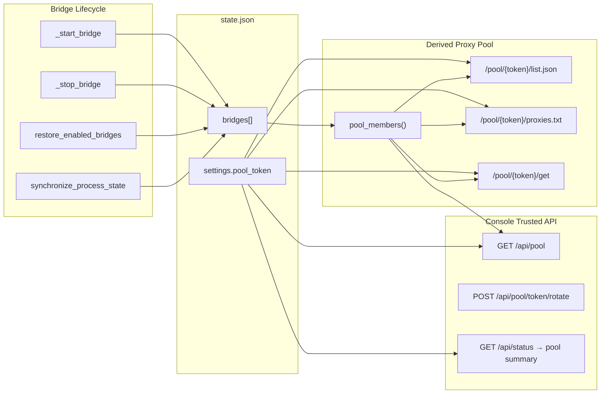
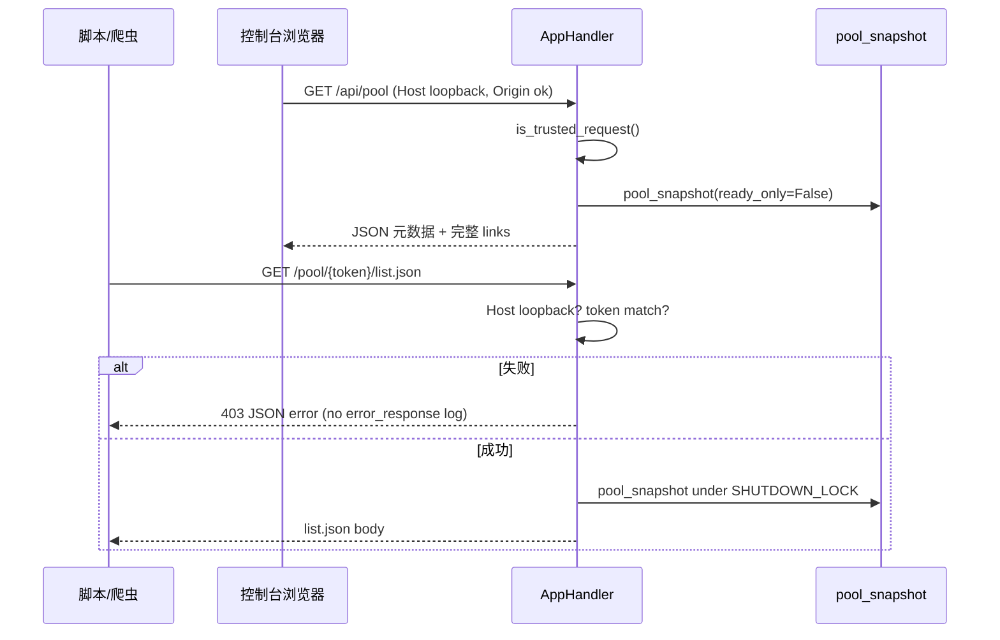
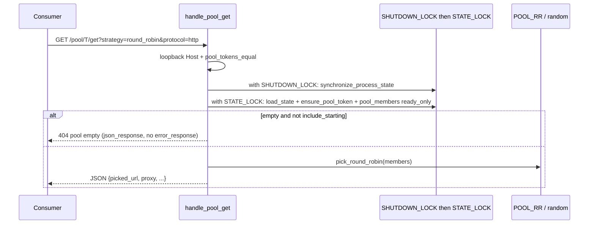

# 设计文档：代理池 (Proxy Pool)

| 字段 | 值 |
|------|-----|
| **Title** | ProxyBridge 代理池 (Proxy Pool) |
| **Author** | ProxyBridge maintainers |
| **Date** | 2026-07-12 |
| **Status** | Draft (post-review revision) |
| **Related** | `app.py` bridge lifecycle, `docs/superpowers/specs/2026-07-10-lifecycle-resource-ownership-design.md` |

---

## Overview

ProxyBridge 已为每个已启动节点创建**本地双协议代理端口**（同一端口同时提供 `socks5://127.0.0.1:PORT` 与 `http://127.0.0.1:PORT`，由 `Socks5LogProxy` 实现）。用户需要把这些「已在跑的本地 HTTP/SOCKS5」自动汇成一个**代理池**，并给出可请求的 URL，供爬虫、脚本、其他桌面工具拉取代理列表或按策略取一条代理。

本设计将代理池实现为 **bridges 的派生视图（derived view）**，不引入独立可写的 pool 成员表。成员资格完全由 bridge 生命周期状态决定；对外暴露一组带 **pool token** 的 discovery URL，以及控制台侧的元数据/复制入口。实现保持增量：主要扩展 `app.py` 的 Handler 与若干纯函数，UI 仅在「本地代理」视图增加最小卡片。

---

## Background & Motivation

### 当前状态

- 本地代理生命周期：`start_bridge` / `_start_bridge`、`stop_bridge` / `_stop_bridge`、`restore_enabled_bridges()`、`synchronize_process_state()`（见 `app.py`）。
- 成功启动时 bridge 记录写入 `state["bridges"]`，关键字段包括：
  - `id`, `node_id`, `node_name`, `protocol`, `region`, `port`
  - `socks_url`, `http_url`
  - `supported_proxy_protocols`: `["socks5", "http", "https-connect"]`
  - `enabled: True`, `status: "running" | "starting" | ...`
- `ACTIVE_BRIDGE_STATUSES = {"running", "starting"}`（`app.py` L48）。
- `enabled` 语义是**用户希望跨重启恢复**（`restore_enabled_bridges` 读取 `enabled` 或活动 status）；`stop_bridge` 经 `persist_stopped_bridges(..., disable=True)` 将 `enabled=False`。
- Web 控制台：`ThreadingHTTPServer` 绑定 **`127.0.0.1`**，默认端口 `8787`（`PROXY_BRIDGE_PORT` 可覆盖）。
- API 统一在 `AppHandler.do_GET` / `do_POST`，`is_trusted_request()` 门禁：Host 必须 loopback，且拒绝 cross-site / 非 loopback Origin。
- 状态：`work/state.json` 或菜单栏 App 的 `~/Library/Application Support/ProxyBridge`（经 `PROXY_BRIDGE_WORKDIR`）。
- 控制台已有「本地代理」卡片，可复制单节点 SOCKS/HTTP URL，但**没有聚合列表 URL**，外部工具只能轮询 `/api/status`（体量大、需可信来源、且返回完整节点/订阅等敏感面）。

### 痛点

1. 多节点启动后，脚本侧需要自己解析 `/api/status` 或手工复制每个端口。
2. 爬虫 / 代理池消费者习惯 **JSON 列表**、**纯文本一行一个**、或 **每次请求取一条**；当前没有对应接口。
3. 希望「启停即同步」：不能维护第二套易漂移的成员名单。
4. 生命周期所有权已有明确约束（进程/代理登记与撤销规则）；池功能不得另立一套 bridge 启停路径。

---

## Goals & Non-Goals

### Goals (v1)

1. **自动入池**：凡当前活动中的本地代理（见下文 **list membership**）自动成为池成员，无需「手动加入池」。
2. **Discovery URL**：提供可复制的链接，客户端 `GET` 即可获得代理信息（JSON 列表 + 纯文本 + 单条选取）。
3. **选择与过滤**：支持 list-all；pick-one 支持 `random` 与 `round_robin`；支持按 `region` / 节点名（`q`）过滤成员；`protocol` 仅控制**输出 URL 形态**（非成员过滤，见 K10）。
4. **安全**：池消费端与控制台 API 分离鉴权模型；tokenized path；仍仅 loopback；access log 脱敏 token。
5. **生命周期耦合**：纯派生，无第二状态源；启停/失败/恢复后下一次请求自然反映最新成员。
6. **最小 UI**：在「本地代理」视图展示成员数与链接复制；不新开侧边栏视图。
7. **一致性**：遵循 `STATE_LOCK` / `SHUTDOWN_LOCK`、`log_event`、`json_response` / Handler 风格与 `tests/` 回归方式。

### Non-Goals (v1)

- 不做多租户 / 云端代理市场。
- 不把 HTTP 服务绑定到 `0.0.0.0` 或做局域网分享（可后续单独设计）。
- 不改 bridge 生命周期所有权、不改 `socks_url`/`http_url` 格式、不改 `PROCESS_TABLE` / `LOG_PROXY_TABLE` 语义。
- 不做 PAC、Clash `proxy-providers`、订阅式 YAML 导出（列入 v2）。
- 不做 least-connections / 按实时 RTT 选路（可复用 `TRAFFIC_TABLE` / 节点测试，列入 v2）。
- 不做 per-bridge「排除出池」开关（v1 所有 list-member 均入池）。
- 不把 pool 成员写入独立持久化列表。
- 不在 v1 跳过进程同步（节流优化属 v1.1，见 K8）。

---

## Key Decisions

| # | 决策 | 理由 |
|---|------|------|
| K1 | **池 = bridges 派生视图**，不建独立 `pool_members` 持久化表 | 避免与 `start_bridge`/`stop_bridge`/`restore_enabled_bridges`/`synchronize_process_state` 双写漂移；符合「生命周期所有权不另立路径」约束 |
| K2 | **入池用 activity（status+port），不用单独 `enabled`；list 与 pick 契约分层** | `enabled` 表示恢复意图；`enabled=true` 且 `status=failed` 时端口不可用。**List membership** = `status ∈ ACTIVE_BRIDGE_STATUSES` 且 `port > 0`（与 `active_bridge_for_node` / UI `runningBridges` 对齐，便于发现）；**Pick readiness** = list member 且 `status=="running"` 且 `bridge_runtime_is_active(id)`。List **可能短暂包含**尚未就绪的 `starting`（restore 窗口、`wait_for_port` 超时窗口），由 `"status":"starting"` 标明；`/get` 默认不选它们 |
| K3 | **消费端路径 `/pool/{token}/...`，与 `/api/*` 鉴权分离** | 脚本/爬虫无 Origin、不应依赖控制台 CSRF 模型；token 提供可轮换的秘密路径，控制台仍用 `is_trusted_request` |
| K4 | **v1 格式：JSON list + text list + pick-one** | 覆盖最常见消费者；PAC/Clash 延后 |
| K5 | **pick 策略 v1：`random` + `round_robin`** | 实现简单、无额外运行时依赖；least-conn/region-weighted 延后 |
| K6 | **`pool_token` 持久化在 `state.json`** | 重启后链接稳定；首次生成 `secrets.token_urlsafe`；支持 rotate |
| K7 | **UI 挂在「本地代理」视图顶部卡片** | 用户心智与「已启用的本地代理」一致；改动面最小 |
| K8 | **Pool 读路径必须先 `synchronize_process_state`，锁序固定** | 与 `_status_payload` 同模式，避免已死进程仍被列出。**v1 强制 sync**；节流/轻量路径属 v1.1 优化，不是 v1 可选项。规范锁序：`SHUTDOWN_LOCK` → sync → `STATE_LOCK`；禁止持 `STATE_LOCK` 时再取 `SHUTDOWN_LOCK`；禁止在仅持 `STATE_LOCK` 时调用 `synchronize_process_state` |
| K9 | **`/get` 默认 `ready_only=True` + runtime active** | 脚本拿到的 `picked_url` 应尽量可连。可选 `?include_starting=1` 放宽为 list membership（仍建议 runtime active 优先）。签名上 `pool_members(..., ready_only=False)` 仅用于 list；get 路径显式传 `ready_only=True` |
| K10 | **`protocol` 是 URL 输出偏好，不是成员过滤器** | 每个本地端口同时支持 socks5+http；`protocol` **永不**因双协议而把 bridge 移出池。`pool_members` 不接受 `protocol`；`select_proxy_url` / `render_proxies_txt` / pick payload 使用它。非法值（如 `protocol=vless`）→ **400** |
| K11 | **`proxies.txt` 默认双协议两行；`status.pool.links` v1 内嵌完整 token** | Text 默认每成员 socks5 一行 + http 一行（socks 在前），`?protocol=` 可收窄。控制台 `/api/status` 已可信，links 内嵌 token 避免 UI 二次请求；暴露面可接受 |
| K12 | **Access log 必须脱敏 pool token** | `AppHandler.log_message` 默认会把完整 path 打到 stdout（菜单栏重定向到 `menubar-backend.log`）。未脱敏则 rotate 无法修复「日志落盘泄露」 |
| K13 | **池鉴权失败与空池 404 不走 `error_response`** | `error_response` 会 `log_event` 刷系统日志；探测/错 token 用 `json_response(..., 403)` 静默返回 |

---

## Proposed Design

### 1. 概念模型



**核心原则**：池没有「加入/移除」API。启动本地代理 ⇒ 自动出现在 list 中；停止或失败 ⇒ 自动消失。

### 2. 成员资格定义

明确区分四个相关概念：

| 概念 | 定义 | 用途 |
|------|------|------|
| **enabled** | `bridge["enabled"] is True` | 用户意图：App 重启时 `restore_enabled_bridges` 尝试拉起 |
| **active status** | `bridge["status"] in ACTIVE_BRIDGE_STATUSES` 即 `{"running","starting"}` | 状态机上的活动中 |
| **list member（v1）** | `is_pool_member`：active status + `port > 0` | `list.json` / `proxies.txt` / admin `members` — **可发现**，可能短暂未监听 |
| **pick-ready member（v1）** | list member 且 `status=="running"` 且 `bridge_runtime_is_active(id)` | `/get` 默认候选 — **尽量可连** |

```python
def is_pool_member(bridge: dict[str, Any]) -> bool:
    """List membership: discoverable active local proxy (may still be starting)."""
    if bridge.get("status") not in ACTIVE_BRIDGE_STATUSES:
        return False
    port = safe_int(bridge.get("port"), 0)
    if port <= 0:
        return False
    # socks_url / http_url 可缺省，由 port 推导（与 load_state 规范化一致）
    return True


def is_pick_ready_member(bridge: dict[str, Any]) -> bool:
    """Pick readiness: prefer actually serving endpoints."""
    if not is_pool_member(bridge):
        return False
    if bridge.get("status") != "running":
        return False
    bridge_id = str(bridge.get("id") or "")
    if not bridge_id or not bridge_runtime_is_active(bridge_id):
        return False
    return True
```

**诚实表述「可服务」**：

- 产品口语「已经启用的 HTTP/SOCKS5」映射为 **activity 成员**（list），不是 `enabled` 标志。
- List **不保证** TCP 立即可连：例如
  1. `_start_bridge` 在 `wait_for_port(local_port)` 1s 超时后仍可能以 `status="starting"` 落盘（进程仍在）；
  2. `restore_enabled_bridges` 先把候选标为 `starting` 并保留旧 port，再异步 `start_bridge` 重绑——窗口内 URL 可能未监听。
- 客户端若需要「保证可连」，应使用 **`/get`（默认 ready）** 或在 list 中过滤 `status=="running"` 并自行探测。

**与 `enabled` 的关系**：

- **不以 `enabled` 单独入池**：`enabled=True` 且 `status=failed` **不得**进入池。
- **不以 `enabled=False` 排除 running**：正常路径下 running 必 enabled；异常数据下只要 status+port 满足仍暴露（防御性）。

**ready vs starting（v1 定稿）**：

| 场景 | list / proxies.txt / admin members | pick (`/get`) 默认 |
|------|--------------------------------------|-------------------|
| `status=running` 且 runtime active | 包含 | 候选 |
| `status=running` 但 runtime 不 active | 包含（sync 后通常会变为 stopped） | **排除** |
| `status=starting` | **包含**，`"status":"starting"` | **排除**（除非 `?include_starting=1`） |
| 请求前 | **必须** `synchronize_process_state()` 再读 state | 同左 |

```python
def pool_members(
    state: dict[str, Any],
    *,
    region: str | None = None,
    q: str | None = None,          # node_name 子串，大小写不敏感
    ready_only: bool = False,      # False = list membership; True = pick-ready
) -> list[dict[str, Any]]:
    """Membership only. Does NOT take protocol (see select_proxy_url)."""
    ...
```

- **排序**：稳定排序，按 `node_name` 升序，再按 `port`、`id`，保证 text 列表与 round-robin 可预期。
- **`protocol` 不在此函数**：见 §3b。

### 3. 公开成员投影

不要把 `config_path`、`log_path`、`pid`、核心配置细节泄漏到 pool 消费端。

```python
def public_pool_member(bridge: dict[str, Any]) -> dict[str, Any]:
    port = safe_int(bridge.get("port"), 0)
    socks = bridge.get("socks_url") or (f"socks5://127.0.0.1:{port}" if port else "")
    http = bridge.get("http_url") or (f"http://127.0.0.1:{port}" if port else "")
    return {
        "id": bridge.get("id"),
        "node_id": bridge.get("node_id"),
        "node_name": bridge.get("node_name"),
        "region": bridge.get("region") or "",
        "node_protocol": bridge.get("protocol") or "",  # vless/vmess/... 节点协议
        "port": port,
        "socks_url": socks,
        "http_url": http,
        "supported_proxy_protocols": bridge.get("supported_proxy_protocols")
            or ["socks5", "http", "https-connect"],
        "status": bridge.get("status"),
    }
```

字段命名：用 `node_protocol` 避免与查询参数 `protocol=socks5|http` 混淆。

### 3b. 输出协议偏好（非过滤）

```python
ALLOWED_PROXY_PROTOCOLS = frozenset({"socks5", "http"})

def parse_protocol_param(raw: str | None) -> str | None:
    """None = caller default. Invalid non-empty → raise ValueError → 400."""
    if raw is None or raw == "":
        return None
    value = raw.strip().lower()
    if value not in ALLOWED_PROXY_PROTOCOLS:
        raise ValueError("protocol 只能是 socks5 或 http")
    return value


def select_proxy_url(member: dict[str, Any], protocol: str | None) -> str:
    """Map a public member + preferred local proxy protocol → single URL."""
    preferred = protocol or "socks5"
    if preferred == "http":
        return str(member.get("http_url") or "")
    return str(member.get("socks_url") or "")


def render_proxies_txt(members: list[dict[str, Any]], protocol: str | None) -> str:
    """
    protocol is None → each member emits socks5 line then http line.
    protocol is socks5|http → one line per member for that scheme only.
    """
    lines: list[str] = []
    for m in members:
        if protocol is None:
            lines.append(str(m.get("socks_url") or ""))
            lines.append(str(m.get("http_url") or ""))
        else:
            lines.append(select_proxy_url(m, protocol))
    return "".join(f"{line}\n" for line in lines if line)
```

**契约（K10 + K11）**：

| 端点 | `protocol` 作用 |
|------|-----------------|
| `list.json` | **忽略成员集合**；响应中每个对象仍含 `socks_url` 与 `http_url`。若传入非法值 → 400。合法值可原样回显在顶层 `"protocol": "socks5"` 字段供客户端记录偏好，但不删减 `proxies[]` |
| `proxies.txt` | 控制输出行（默认双行；指定则单协议） |
| `/get` | 控制 `picked_url`（默认 `socks5`） |

### 4. Token 与配置持久化

#### 4.1 存储位置

在 `state.json` 增加可选顶层对象（向后兼容）：

```json
{
  "subscriptions": [],
  "nodes": [],
  "bridges": [],
  "browser_instances": [],
  "tests": {},
  "request_logs": [],
  "settings": {
    "pool_token": "urlsafe-token-here"
  }
}
```

- `empty_state()` 可仍不强制写入 `settings`；`ensure_pool_token(state)` 在读取时惰性创建。
- `load_state()` 规范化：若 `settings` 非 dict 则重置为 `{}`；不因缺 token 失败。

#### 4.2 生成与校验

```python
import hmac
import secrets

POOL_TOKEN_MIN_LEN = 16
POOL_TOKEN_MAX_LEN = 128
# 字符集与 BACKEND_INSTANCE_TOKEN_PATTERN 对齐（path 安全）；长度策略刻意更严（后端实例 token 允许 min 1）
POOL_TOKEN_PATTERN = re.compile(r"[A-Za-z0-9._~-]+")

def new_pool_token() -> str:
    return secrets.token_urlsafe(24)  # ~32 chars, url-safe; fits MIN/MAX

def ensure_pool_token(state: dict[str, Any]) -> tuple[str, bool]:
    """Return (token, changed). Caller must save_state if changed under STATE_LOCK."""
    settings = state.setdefault("settings", {})
    if not isinstance(settings, dict):
        settings = {}
        state["settings"] = settings
    token = str(settings.get("pool_token") or "")
    if not (POOL_TOKEN_MIN_LEN <= len(token) <= POOL_TOKEN_MAX_LEN) or POOL_TOKEN_PATTERN.fullmatch(token) is None:
        token = new_pool_token()
        settings["pool_token"] = token
        return token, True
    return token, False


def pool_tokens_equal(provided: str, expected: str) -> bool:
    """Constant-time compare; both sides must already be str (reject empty before this)."""
    if not provided or not expected:
        return False
    return hmac.compare_digest(provided, expected)
```

- **Charset**：与 `BACKEND_INSTANCE_TOKEN_PATTERN` 相同（`[A-Za-z0-9._~-]+`），便于 path 安全。
- **Length**：故意比后端实例 token 更严（min 16），新生成 token 始终满足。
- **Rotate**：`POST /api/pool/token/rotate` 生成新 token 并 `save_state`；旧 URL 立即 **403**（统一不用 401，避免浏览器弹认证框）。
- **禁止**把 token 写入 `log_event` 明文（rotate 时只 log「代理池 token 已轮换」）。
- **禁止** access log 明文 path token（K12，见 §5.1 `log_message`）。
- Path 解析时：空 token 段（`/pool//list.json`）在 `compare_digest` 前即判失败 → 403。

#### 4.3 服务基址

```python
def console_base_url() -> str:
    port = safe_int(os.environ.get("PROXY_BRIDGE_PORT"), DEFAULT_SERVER_PORT)
    # 始终使用 127.0.0.1，即使用户用 http://localhost:PORT 打开控制台。
    # 服务器 bind 地址即为 127.0.0.1；链接契约固定，避免 Host 差异。
    return f"http://127.0.0.1:{port}"
```

池链接示例：

```text
http://127.0.0.1:8787/pool/<token>/list.json
http://127.0.0.1:8787/pool/<token>/proxies.txt
http://127.0.0.1:8787/pool/<token>/get?strategy=random&protocol=socks5
```

### 5. HTTP 接口设计

#### 5.0 规范 Pool 读路径（锁序 / 同步）

所有需要「当前成员快照」的入口（消费端 list/txt/get、控制台 `GET /api/pool`、`_status_payload` 的 pool 摘要）遵循同一临界区模式，与 `_status_payload` 对齐：

```python
def pool_snapshot(*, ready_only: bool = False, region=None, q=None) -> dict[str, Any]:
    """Normative read path. Never call synchronize_process_state while holding only STATE_LOCK."""
    with SHUTDOWN_LOCK:
        synchronize_process_state()  # 内部可再取 STATE_LOCK（RLock）；外层已持 SHUTDOWN_LOCK
        with STATE_LOCK:
            state = load_state()
            # 可选：与 status 一样刷新 running 元数据
            changed = sync_process_status(state)
            token, token_changed = ensure_pool_token(state)
            members = pool_members(state, region=region, q=q, ready_only=ready_only)
            if changed or token_changed:
                save_state(state)
            return {
                "token": token,
                "members": [public_pool_member(m) for m in members],
                "updated_at": now_ts(),  # 与项目现有 now_ts() 一致，非 time.time 直调
            }
```

**锁规则（规范性）**：

1. 顺序：**`SHUTDOWN_LOCK` →（sync）→ `STATE_LOCK`**。与 `status_payload` / `start_bridge` / `stop_bridge` 一致。
2. **禁止** `STATE_LOCK` → `SHUTDOWN_LOCK`（会死锁）。
3. **禁止**在仅持 `STATE_LOCK` 时调用 `synchronize_process_state`。
4. `ensure_pool_token` 的首次生成与 `save_state` 必须在 **同一 `STATE_LOCK` 临界区**完成，避免 `ThreadingHTTPServer` 双线程写出两个不同 token。
5. **v1 不得跳过** `synchronize_process_state`。高频轮询导致的锁竞争在 Rollout 记为中风险；v1.1 可考虑节流（例如 200ms 内复用上次 sync），但不是 v1 范围。

#### 5.1 鉴权分层



**Handler 结构调整**（关键）：

```python
def do_GET(self) -> None:
    parsed = urllib.parse.urlsplit(self.path)
    if parsed.path.startswith("/pool/"):
        self.handle_pool_get(parsed)
        return
    if not self.is_trusted_request():
        self._send_request_error(403, "不可信请求来源")
        return
    ...


def do_HEAD(self) -> None:
    parsed = urllib.parse.urlsplit(self.path)
    if parsed.path.startswith("/pool/"):
        self.handle_pool_head(parsed)  # 与 GET 同鉴权；成功时 Content-Length 按将返回 body 计算，不写 body
        return
    if not self.is_trusted_request():
        self._send_request_error(403, "不可信请求来源")
        return
    ...
```

**Access log 脱敏（K12）**：

`BaseHTTPRequestHandler.log_request` 传入 `log_message` 的参数是**完整 requestline**（例如 `GET /pool/<token>/list.json HTTP/1.1`），不是裸 path。因此脱敏正则**不得**用 `^…$` 锚定整串——否则 `.sub()` 对 requestline 是 no-op，token 仍会落盘。

```python
# 无 ^/$：同时匹配裸 path 与完整 requestline / 其它含 path 的日志串。
# token 段排除空白，避免吞掉 " HTTP/1.1"。
_POOL_PATH_REDACT = re.compile(r"(/pool/)([^/\s]+)(/[^\s]*)?")

def log_message(self, fmt: str, *args: Any) -> None:
    # BaseHTTPRequestHandler 将 requestline 放入 args；必须脱敏后再写 stdout
    safe_args = tuple(_redact_pool_token_in_log_arg(a) for a in args)
    sys.stdout.write("[%s] %s\n" % (self.log_date_time_string(), fmt % safe_args))


def _redact_pool_token_in_log_arg(value: Any) -> Any:
    if not isinstance(value, str) or "/pool/" not in value:
        return value
    # "GET /pool/<token>/list.json HTTP/1.1" → "GET /pool/***/list.json HTTP/1.1"
    # "/pool/<token>/proxies.txt"           → "/pool/***/proxies.txt"
    return _POOL_PATH_REDACT.sub(r"\1***\3", value)
```

**规范性要求**（实现验收，不只是示例）：

1. 对 **requestline 形态** 与 **裸 path 形态** 均须脱敏成功。
2. 禁止把「仅匹配 `^/pool/...$`」当作完成 K12。
3. 可选加强：在 `log_message` 内同时脱敏 `getattr(self, "requestline", "")` / `self.path` 再格式化，但 args 脱敏仍是底线（`log_request` 默认走 args）。
4. **PR1 测试必须断言**：对 `GET /pool/{token}/list.json HTTP/1.1` 调用 `log_message` 后，写入 stdout 的字节中**不包含** raw token。

`handle_pool_get` / `handle_pool_head`：

1. `Host` 必须 `_is_loopback_host`（否则 403，文案统一）。
2. 解析 path（见 §5.1.1）；畸形 → 规定状态码。
3. 空 token 或 `pool_tokens_equal` 失败 → 403。
4. 鉴权失败响应（K13）：

```python
json_response(self, {"error": "无效的代理池凭证"}, 403)
# 不要调用 error_response —— 避免每条探针写入系统日志
```

5. 成功则按 action 响应（HEAD 只发头）。

**为何不单靠现有 trusted 检查**：

- 本地 curl 无 Origin 时 `is_trusted_request` 已可通过，但路径可被猜测（`/api/status` 已暴露全部 bridges）。
- Token 路径把「池」做成**最小权限面**的稳定合约，且可轮换。
- 控制台恶意页面：跨站已被 `Sec-Fetch-Site` / Origin 拒绝；token 不出现在静态 HTML 源码中（由 `/api/status` 或 `/api/pool` 动态下发，同源）。

##### 5.1.1 Path 解析与畸形路由（v1 定稿）

合法 path（`urlsplit(...).path`，先做百分号解码再分段）：

```text
/pool/{token}/{action}
```

- `token`：非空，且匹配 `POOL_TOKEN_PATTERN` 的**候选**（不匹配则直接 403，不调用 ensure 去「纠正」攻击者输入）。
- `action ∈ {"list.json", "proxies.txt", "get"}`。

| Path | 状态 | Body |
|------|------|------|
| `/pool/{token}/list.json` 等合法 | 鉴权后 200/404（get 空池） | 见下 |
| `/pool/`、`/pool` | **404** | `{"error":"未找到代理池资源"}` |
| `/pool/{token}`（无 action） | **404** | 同上 |
| `/pool/{token}/` | **404** | 同上 |
| `/pool/{token}/unknown` 或多余段 `/pool/{token}/get/extra` | **404** | 同上 |
| token 为空（`/pool//list.json`） | **403** | `{"error":"无效的代理池凭证"}` |
| token 字符非法（含空格、`/` 已分段等） | **403** | 同上（不区分「格式错 / 密钥错」，防探测） |
| 鉴权成功但 query 非法（`protocol=vless`、`strategy=foo`） | **400** | `{"error":"..."}` — 可用 `error_response` 或 `json_response`；400 属客户端错误，允许记系统日志 |
| Host 非 loopback | **403** | 无效凭证文案（不泄露原因） |

**HEAD**：

- v1 **支持**与 GET 相同的 `/pool/` 分支与鉴权。
- 成功：与对应 GET 相同的 `Content-Type` / `Content-Length`（按将生成的 body 计算），**不写 body**。
- 失败：与 GET 相同状态码与 JSON Content-Type/Length（与现有 `_send_request_error` HEAD 行为一致时可复用模式）。
- 不实现「405 Method Not Allowed」——对 pool 资源 HEAD 合法。

**URL 编码**：token 中的 `token_urlsafe` 字符一般无需编码；若客户端编码了 `-` `_` 等，解码后按明文比较。

#### 5.2 控制台 API（trusted）

##### `GET /api/pool`

v1 **始终**返回 `members` 数组（可为 `[]`），不再标「可选」。

```json
{
  "member_count": 2,
  "base_url": "http://127.0.0.1:8787/pool/TOKEN",
  "links": {
    "list_json": "http://127.0.0.1:8787/pool/TOKEN/list.json",
    "proxies_txt": "http://127.0.0.1:8787/pool/TOKEN/proxies.txt",
    "get_random": "http://127.0.0.1:8787/pool/TOKEN/get?strategy=random",
    "get_round_robin": "http://127.0.0.1:8787/pool/TOKEN/get?strategy=round_robin",
    "get_random_socks5": "http://127.0.0.1:8787/pool/TOKEN/get?strategy=random&protocol=socks5",
    "get_random_http": "http://127.0.0.1:8787/pool/TOKEN/get?strategy=random&protocol=http"
  },
  "members": [ /* 始终存在：public_pool_member[]，list membership */ ],
  "strategies": ["random", "round_robin"],
  "formats": ["list.json", "proxies.txt", "get"]
}
```

`member_count == len(members)`，基于 **list membership**（含 starting），与侧栏「运行中」计数心智一致。

##### `POST /api/pool/token/rotate`

- Body：`{}` 或省略（须 `Content-Type: application/json`，与其他 POST 一致）。
- 响应：`{"ok": true, "base_url": "...", "links": {...}}`（新 token 嵌在 links 中）。
- 权限：`is_trusted_request` only。
- `log_event("代理池 token 已轮换", category="代理")` — **不**包含 token 明文。

##### `status_payload` 增量

在 `_status_payload()` 返回中增加（K11：links **内嵌完整 token**）：

```python
"pool": {
    "member_count": <int>,
    "base_url": <str>,
    "links": { ... }  # 与 /api/pool.links 同形
}
```

构造时复用 `pool_snapshot` 已同步的 state，**不要**在 `_status_payload` 已持锁后再嵌套一次完整 double-sync；推荐在 `_status_payload` 现有 `synchronize_process_state` + `STATE_LOCK` 块内调用 `ensure_pool_token` + `pool_members`，避免重复 sync。

注意：token 出现在 status 里——仅可信控制台可拉 `/api/status`，v1 可接受。

#### 5.3 消费端 API（token + loopback）

通用 query：

| 参数 | 适用 | 说明 |
|------|------|------|
| `protocol` | txt/get；（list 仅校验） | `socks5` \| `http`；**不**过滤成员。省略：txt 双行；get 默认 `socks5`；list 仍返回双 URL 字段 |
| `region` | list/text/get | 精确匹配 `bridge.region`（如 `香港`） |
| `q` | list/text/get | `node_name` 大小写不敏感子串 |
| `strategy` | get only | `random`（默认）\| `round_robin`；非法 → 400 |
| `format` | get only | `json`（默认）\| `text`（只返回一行 URL） |
| `include_starting` | get only | `1` / `true` 时放宽候选为 list membership（仍优先 runtime active 若实现二次过滤）；默认关闭 |

##### `GET /pool/{token}/list.json`

```json
{
  "count": 2,
  "updated_at": 1720000000.12,
  "proxies": [
    {
      "id": "…",
      "node_id": "…",
      "node_name": "香港 A",
      "region": "香港",
      "node_protocol": "vless",
      "port": 21080,
      "socks_url": "socks5://127.0.0.1:21080",
      "http_url": "http://127.0.0.1:21080",
      "supported_proxy_protocols": ["socks5", "http", "https-connect"],
      "status": "running"
    }
  ]
}
```

- `updated_at`：`now_ts()`（与项目既有时间戳函数一致）。
- Content-Type: `application/json; charset=utf-8`
- 空池：`count: 0`, `proxies: []`，HTTP **200**（便于脚本轮询）。
- 成员 = **list membership**（可含 `starting`）。

##### `GET /pool/{token}/proxies.txt`

- Content-Type: `text/plain; charset=utf-8`
- 每行一个 URL；最后一行后单个 `\n`；无多余空行。
- **默认**每个成员输出 **socks5 一行 + http 一行**（socks 在前）（K11）。
- `?protocol=socks5` 或 `http` 时只输出对应协议。
- 空池：空 body，**200**。

示例（默认）：

```text
socks5://127.0.0.1:21080
http://127.0.0.1:21080
socks5://127.0.0.1:21081
http://127.0.0.1:21081
```

##### `GET /pool/{token}/get`

选一条 **pick-ready** 成员（K9）：

1. `pool_snapshot(ready_only=True, ...)` → pick-ready 列表。
2. 若为空且 **未** 设置 `include_starting` → **404**（不 fallback 到 starting，避免静默给出未监听端口）。
3. 若 `include_starting=1` 且 ready 为空 → 再取 list membership；仍空 → 404。
4. `strategy=random`：`random.choice(members)`。
5. `strategy=round_robin`：进程内游标（§5.4）。

**空池响应（K13）**：

```python
# format=json（默认）
json_response(self, {"error": "代理池为空"}, 404)
# format=text
text_response(self, "error: pool empty\n", 404)
# 均不调用 error_response（正常空池轮询不应刷系统日志）
```

JSON 成功响应：

```json
{
  "strategy": "random",
  "protocol": "socks5",
  "picked_url": "socks5://127.0.0.1:21080",
  "proxy": { /* public_pool_member */ }
}
```

`format=text`：body 仅为 `picked_url` + `\n`。

#### 5.4 Round-robin 状态

仅内存，不持久化：

```python
POOL_RR_LOCK = threading.Lock()
POOL_RR_COUNTER = 0  # 单调递增

def pick_round_robin(members: list[dict[str, Any]]) -> dict[str, Any]:
    global POOL_RR_COUNTER
    with POOL_RR_LOCK:
        idx = POOL_RR_COUNTER % len(members)
        POOL_RR_COUNTER += 1
    return members[idx]
```

成员集合变化时模运算自然适应；不要求严格公平跨重启。不同 `region`/`q` 过滤共享同一计数器——文档说明即可，v1 可接受。

### 6. 核心函数落点（`app.py`）

建议新增纯函数区域（在 `status_payload` 附近或 bridge helpers 之后），便于单测：

| 函数 | 职责 |
|------|------|
| `ensure_pool_token(state) -> tuple[str, bool]` | 惰性创建/校验 token；返回是否变更 |
| `pool_tokens_equal(a, b) -> bool` | `hmac.compare_digest` |
| `rotate_pool_token() -> dict` | 可信 API：新 token + links |
| `console_base_url() -> str` | 固定 `127.0.0.1` base |
| `is_pool_member(bridge) -> bool` | list 成员谓词 |
| `is_pick_ready_member(bridge) -> bool` | pick 就绪谓词 |
| `public_pool_member(bridge) -> dict` | 对外投影 |
| `pool_members(state, *, region, q, ready_only) -> list` | **仅**成员过滤 + 排序（无 protocol） |
| `parse_protocol_param` / `select_proxy_url` | 输出协议偏好 |
| `pool_links(token: str) -> dict` | 标准 links 字典 |
| `pool_snapshot(...)` / `pool_admin_payload()` | 规范读路径 + admin |
| `pick_pool_member(members, strategy) -> dict` | random / round_robin |
| `render_proxies_txt(members, protocol) -> str` | 文本渲染 |
| `text_response(handler, body, status=200)` | 平行于 `json_response` |
| `_redact_pool_token_in_log_arg` | access log 脱敏 |

Handler：

- `AppHandler.handle_pool_get(parsed)` / `handle_pool_head(parsed)`
- `do_GET` / `do_HEAD`：`/pool/` 分支先于 trusted
- `do_POST`：`/api/pool/token/rotate`；`do_GET`：`/api/pool`
- `log_message` 覆盖脱敏

**不要**在 `_start_bridge` / `_stop_bridge` 里写 pool 专用副作用；派生视图已足够。

**不要**在 pool 路径调用 `start_bridge`（只读，不隐式启动节点）。

### 7. 生命周期耦合说明

| 事件 | 池行为 |
|------|--------|
| `_start_bridge` 成功，`status=running/starting` | 下一次 list 自动包含；`/get` 仅 running+runtime active |
| `_stop_bridge` → `enabled=False`, `status=stopped` | list 与 get 均排除 |
| 进程崩溃 → `synchronize_process_state` 持久化为 stopped（`disable=False` 保留 enabled） | status 非 active → 排除；enabled 仍 true 供 restore，但不入池 |
| `restore_enabled_bridges` 将候选标 `starting` | list **可能短暂**出现旧 port；get 默认不选 starting |
| restore 成功 `running` | list + get 正常 |
| restore 失败 `status=failed` | 不入池 |
| `shutdown` | 服务停止，URL 不可达；不单独清理 token |

与生命周期资源所有权设计的关系：

- 池**只读** `state["bridges"]` 与 `bridge_runtime_is_active`（pick）。
- 不登记 `PROCESS_TABLE` / `LOG_PROXY_TABLE`，不调用 `stop_process`。
- 不改变「终止成功后才撤销登记」规则。

### 8. UI（最小）

文件：`static/index.html`、`static/app.js`、`static/styles.css`。

在「本地代理」视图（`data-view="bridges"`）toolbar 下方、`#bridgeList` 之前增加：

```html
<section class="pool-card" id="poolCard" aria-label="代理池">
  <div class="pool-card-head">
    <strong>代理池</strong>
    <span class="countline" id="poolMemberCount">0 个成员</span>
  </div>
  <p class="view-hint">自动包含所有运行中/启动中的本地 HTTP / SOCKS5 代理。列表链接可能短暂包含尚未就绪的节点；「随机获取」默认只返回已就绪端口。将链接粘贴到脚本或爬虫即可拉取。</p>
  <div class="pool-link-rows" id="poolLinkRows"><!-- JS 渲染 links 只读展示（可截断显示） --></div>
  <div class="pool-card-actions">
    <button type="button" class="toolbar-button" data-action="copy" id="poolCopyListJson" data-text="">复制 JSON 列表链接</button>
    <button type="button" class="toolbar-button" data-action="copy" id="poolCopyProxiesTxt" data-text="">复制文本列表链接</button>
    <button type="button" class="toolbar-button" data-action="copy" id="poolCopyGet" data-text="">复制随机获取链接</button>
    <button type="button" class="toolbar-button danger" data-action="rotate-pool-token" id="poolRotateToken">轮换密钥</button>
  </div>
</section>
```

JS 接线（PR3 必做）：

1. **`refreshStatus` / `loadStatus`**（现有拉 `/api/status` 的路径）：读取 `status.pool`；设置 `#poolMemberCount`；把 `status.pool.links.list_json|proxies_txt|get_random` 写入对应按钮的 **`dataset.text` / `data-text`**（现有 `data-action="copy"` → `copyText(button.dataset.text)` 路径，约 `app.js` handleAction）。
2. **`handleAction`**：增加分支 `action === "rotate-pool-token"` → `api("/api/pool/token/rotate", {})`，成功后提示并 `refreshStatus()`。
3. **busy-spin**：`rotate-pool-token` **应**进入转圈（写操作）；`copy` 继续排除在 spins 之外（与现网 `copy` 一致，约 L883–884）。
4. 空池时仍显示链接（脚本可轮询）；hint 提示「启动节点后成员数增加」。
5. 不新增侧边栏 nav item（v1）。

### 9. 数据流（pick 一次请求）



---

## API / Interface Changes

### 新增路由

| Method | Path | Auth | 说明 |
|--------|------|------|------|
| GET | `/api/pool` | trusted | 元数据 + **始终含** members + links |
| POST | `/api/pool/token/rotate` | trusted | 轮换 token |
| GET | `/pool/{token}/list.json` | loopback + token | JSON 列表（list membership） |
| GET | `/pool/{token}/proxies.txt` | loopback + token | 纯文本列表 |
| GET | `/pool/{token}/get` | loopback + token | 取一条（默认 pick-ready） |
| HEAD | `/pool/{token}/…` | 同 GET | 空 body，同鉴权 |

### 既有接口变更

| 接口 | 变更 |
|------|------|
| `GET /api/status` | 响应增加 `pool` 摘要（含 links/token） |
| `empty_state` / `load_state` | 识别/规范化 `settings` |
| `do_GET` / `do_HEAD` | 在 trusted 检查前分支 `/pool/` |
| `AppHandler.log_message` | 脱敏 `/pool/{token}/` |

### 无变更

- `/api/bridges/start|stop|stop-all` 请求/响应形状不变。
- bridge 持久化字段不强制新增 pool 相关列。

---

## Data Model Changes

### `state.json`

```diff
 {
   "subscriptions": [...],
   "nodes": [...],
   "bridges": [...],
   "browser_instances": [...],
   "tests": {},
-  "request_logs": []
+  "request_logs": [],
+  "settings": {
+    "pool_token": "<urlsafe>"
+  }
 }
```

**迁移策略**：

- 读时惰性：`ensure_pool_token` 发现无效/缺失则生成；`changed` 时在持 `STATE_LOCK` 的同一临界区 `save_state`。
- 无版本号 bump；旧文件缺 `settings` 完全兼容。
- 不迁移历史 bridges。

### 内存

| 符号 | 类型 | 持久化 |
|------|------|--------|
| `POOL_RR_COUNTER` | `int` | 否 |
| `POOL_RR_LOCK` | `threading.Lock` | 否 |

### 新增依赖（stdlib）

- `import secrets` — 生成 token  
- `import hmac` — `compare_digest`  
- 仓库当前未使用二者；均为标准库，无第三方依赖。

---

## Alternatives Considered

### A1. 独立可变 pool 表 + 「加入/移出池」API

- **做法**：`state["pool"] = {member_ids: []}`，UI 勾选。
- **优点**：可排除某 running 节点。
- **缺点**：与启停双写；用户忘记加入；restore 后一致性复杂。
- **结论**：拒绝（v1）。若 v2 需要「排除」，用 `bridge["pool_exclude"]=true` 可选字段覆盖派生规则，默认仍自动入池。

### A2. 仅扩展 `/api/status` 或 `/api/bridges`，不设独立 discovery URL

- **优点**：改动最少。
- **缺点**：payload 过大；鉴权绑死控制台模型；不符合「给一个链接」的产品表述；爬虫要解析深层 JSON。
- **结论**：拒绝作为唯一方案；status 仅带摘要。

### A3. 无 token，仅 loopback + trusted 规则

- **优点**：实现更简单。
- **缺点**：路径可枚举；无法轮换失效链接；与「可粘贴给工具的专用链接」产品感弱。
- **结论**：拒绝；token path 成本低、收益高。

### A4. 首版即做 Clash proxy-provider / PAC

- **优点**：对接代理客户端生态。
- **缺点**：格式与调试面大；本产品本地端口已是「终点代理」而非订阅节点分享；优先级低于脚本友好的 json/txt。
- **结论**：延后 v2。

### A5. 绑定 `0.0.0.0` 供局域网设备使用池

- **优点**：手机/其他设备可用。
- **缺点**：显著扩大威胁面，需认证与防火墙产品决策；违背当前 local-first 约束。
- **结论**：非目标；若做必须独立 RFC。

### A6. Query / Header token（`?token=` 或 `Authorization`）代替 path token

- **做法**：`/pool/list.json?token=...` 或 `Authorization: Bearer ...`。
- **优点**：path 不进部分 access log 的「第一段」；Bearer 更符合 HTTP 习惯。
- **缺点**：许多爬虫/代理池消费者期望**单行可复制 URL** 且无自定义头；query token 仍常进 access log 与 Referer；path 在 UI「一键复制」体验最好。
- **结论**：v1 采用 **path token**（K3）；依赖 K12 access log 脱敏。Header token 可作 v2 附加鉴权方式，不替换 path。

### A7. List 与 pick 使用同一「runtime active only」成员谓词

- **优点**：list 永不出现死端口。
- **缺点**：restore/`starting` 窗口成员数跳动；与 UI「运行中/启动中」计数不一致；可发现性变差。
- **结论**：拒绝；采用 K2 分层契约（list discoverable，pick ready）。

---

## Security & Privacy Considerations

### 威胁模型（local-first）

| 威胁 | 缓解 | 严重度 |
|------|------|--------|
| 远程互联网直接访问控制台/池 | 服务只 bind `127.0.0.1` | 已缓解 |
| 恶意网页跨站读 `/api/*` | `is_trusted_request`：Origin / Sec-Fetch-Site | 已有 |
| 恶意网页猜测 `/pool/token` | token 熵足够（`token_urlsafe(24)`）；非同源读需 CORS（默认无 ACAO）；仍建议 rotate | 中 → 低 |
| 本机其他用户/进程读池 | 与读 `state.json` 同级信任边界；可接受 | 低 |
| token 写入 **access log** / 系统日志 / 截图 | K12 `log_message` 脱敏；K13 鉴权失败不 `error_response`；rotate 不 log token；UI 轮换 | 中 → 低 |
| 时序侧信道比 token | `hmac.compare_digest`（两侧均为非空 str） | 低 |
| 池响应泄露节点服务器真实地址 | `public_pool_member` 只暴露本地端口与名称/地区，**不含** `node.server` / uuid / 密码 | 已设计 |
| Host 头伪造 | 要求 loopback Host；非 loopback 403 | 已有模式 |
| list 短暂暴露未监听端口 | 文档 + `/get` ready 默认；客户端过滤 `status` | 低（已知契约） |

### 鉴权矩阵

| 端点 | Host loopback | Origin/Sec-Fetch | Token |
|------|---------------|------------------|-------|
| `/api/*` | 必须 | 按 `is_trusted_request` | 否 |
| `/pool/{token}/*` | 必须 | 不要求 | 必须 |
| 静态资源 | 必须（现状） | 按 trusted | 否 |

### 隐私

- 池输出含 `node_name` / `region`（用户本机节点元数据），无订阅 URL、无节点密钥。
- `pool_token` 存明文于 `state.json`（与现有节点参数明文一致；README 已提示后续 Keychain）。不在 v1 引入 Keychain。

---

## Observability

| 信号 | 方式 |
|------|------|
| Token 轮换 | `log_event(..., category="代理")`，无 token 明文 |
| 消费端 403（错 token / 非 loopback） | **不**写系统日志（`json_response` only） |
| 空池 404 | **不**写系统日志 |
| 非法 query 400 | 可用 `error_response`（低频客户端错误） |
| 未预期异常 | `error_response` → 系统日志 |
| Access log | path token 脱敏为 `/pool/***/…` |

**指标（可选 v1.1）**：内存计数器 `pool_list_hits` / `pool_get_hits` — 非必须。

**告警**：单机菜单栏 App，无远程告警。

---

## Rollout Plan

1. **开发**：按 PR Plan 增量合并；默认功能始终开启（无 feature flag——纯加性 API）。
2. **测试**：单元测试覆盖成员谓词、pick-ready、过滤、token、文本渲染、round-robin、Handler 403/200/404、**log 脱敏**、**错 token 不写系统日志**；回归 `tests/test_security.py`、lifecycle。
3. **发布**：随菜单栏 App 常规构建；首次启动/首次 pool 访问生成 token。
4. **回滚**：去掉 `/pool/` 分支与 UI 卡片即可；遗留 `settings.pool_token` 无害。
5. **兼容**：旧前端忽略 `status.pool`；旧状态文件无 `settings` 自动补全。

### 风险

| 风险 | 严重度 | 缓解 |
|------|--------|------|
| `do_GET` 分支顺序错误导致 pool 被 trusted 误拦或误放 | 高 | 安全测试：loopback+token 无 Origin、非 loopback、错 token、畸形 path；确认 `/api/*` 仍走 trusted |
| `synchronize_process_state` 在高频 pool 轮询下加重锁竞争 | 中 | v1 强制 sync；v1.1 再考虑节流，**不**在 v1 跳过 |
| 双线程首次 `ensure_pool_token` 竞态 | 中 | 同 `STATE_LOCK` 临界区生成 + save |
| Access log 忘记脱敏 | 高 | 强制测试 + code review checklist |
| UI 把 token 永久显示导致录屏泄露 | 低 | 轮换按钮 + 文案提示 |
| round-robin 全局计数跨过滤条件 | 低 | 文档说明；可接受 |
| list 含 starting 被当成可连 | 低 | 文档 + UI hint + `/get` ready 默认 |

**延迟目标**：本机 list/get P99 < 50ms（主要成本为 sync + state 读）；不引入网络出站。

**负载**：预期并发为个位脚本轮询（1–10 QPS）；`ThreadingHTTPServer` 足够。

---

## Testing Plan

新增 `tests/test_proxy_pool.py`（风格对齐 `test_security.py` / lifecycle）：

1. `is_pool_member`：running+port 入选；failed/stopped/enabled-only 排除；starting **入选 list**。
2. `is_pick_ready_member`：starting 排除；running 但 runtime 不 active 排除；running+active 入选。
3. `pool_members`：region、q、排序稳定；**无 protocol 参数**。
4. `parse_protocol_param` / `select_proxy_url` / `render_proxies_txt`：双协议 / 单协议；非法 protocol 抛错。
5. `ensure_pool_token`：缺省生成；非法 token 重置；合法保留；并发临界区由锁测/文档保证。
6. `pick_round_robin`：N 次覆盖轮转。
7. Handler：
   - 正确 token + loopback + **无 Origin** → 200 list.json
   - 错误 token → 403，且 **SYSTEM_LOGS 不新增**鉴权失败条目
   - Host 非 loopback → 403
   - 畸形 path → 404/403 按表
   - 空池 get → 404，不写系统日志
   - `/api/pool` 无 trusted → 403
   - rotate 后旧 token 403、新 token 200
   - **access log / log_message**：捕获 stdout，断言原始 token **不出现**
   - HEAD 合法 pool path → 200 空 body（或与 Content-Length 一致）
8. `status_payload` 含 `pool.member_count` 与 list membership 一致；`links` 含 token。

不依赖真实 sing-box/xray。

---

## Open Questions

（Q1–Q3 已关闭，见 K9–K11。）

1. ~~`starting` 是否出现在 `/get` 默认候选？~~ → **K9**：默认否；`include_starting=1` 可放宽。
2. ~~`status.pool.links` 是否内嵌完整 token？~~ → **K11**：v1 内嵌。
3. ~~text 列表默认是否双协议两行？~~ → **K11**：是。

**仍开放（非 v1 阻塞）**：

4. **是否在 v1 提供「暂停池」总开关？**  
   建议不做；停止全部本地代理即空池。若产品坚持，可后续加 `settings.pool_enabled`。

5. **菜单栏 Swift 壳是否展示池链接？**  
   v1 不做；Web 控制台足够。

---

## References

- 代码：`app.py`  
  - `ACTIVE_BRIDGE_STATUSES`, `start_bridge` / `_start_bridge`, `stop_bridge`, `restore_enabled_bridges`  
  - `status_payload` / `_status_payload`  
  - `AppHandler.is_trusted_request`, `do_GET`, `do_HEAD`, `do_POST`, `log_message`  
  - `Socks5LogProxy`, `bridge_runtime_is_active`, `synchronize_process_state`, `now_ts`
- 前端：`static/index.html`, `static/app.js`（`runningBridges`, `renderBridges`, `handleAction`, `refreshStatus`）
- 安全测试：`tests/test_security.py`
- 生命周期设计：`docs/superpowers/specs/2026-07-10-lifecycle-resource-ownership-design.md`
- 产品说明：`README.md`

---

## 格式版本规划

| 格式 | v1 | v2+ |
|------|----|-----|
| JSON list (`list.json`) | ✅ | |
| Plain text (`proxies.txt`) | ✅ | |
| Pick one (`get` random/rr) | ✅ | |
| PAC (`proxy.pac`) | | ✅ |
| Clash proxy-provider YAML | | ✅ |
| least-connections / latency-based pick | | ✅ |
| per-bridge pool_exclude | | ✅ optional |
| Header/Bearer token 附加鉴权 | | ✅ |
| 局域网 bind + 加强认证 | | 独立设计 |
| sync 节流（v1.1） | | ✅ optional |

---

## PR Plan

### PR 1 — 代理池核心：成员派生、token、消费端端点

- **Title**：`feat(pool): derived proxy pool membership and tokenized discovery endpoints`
- **Files/components**：
  - `app.py`：`ensure_pool_token`, `pool_tokens_equal`, `is_pool_member`, `is_pick_ready_member`, `public_pool_member`, `pool_members`, `parse_protocol_param`, `select_proxy_url`, `pool_links`, `pool_snapshot`, `pick_*`, `render_proxies_txt`, `text_response`, `handle_pool_get` / `handle_pool_head`, `do_GET`/`do_HEAD` 分支，`log_message` 脱敏，`load_state` 对 `settings` 规范化，RR 全局状态，`import hmac` / `import secrets`
  - `tests/test_proxy_pool.py`：谓词、token、list/txt/get、鉴权、畸形 path、log 脱敏、403 不写系统日志
- **Dependencies**：无
- **Description**：实现派生成员与 `/pool/{token}/list.json|proxies.txt|get`（及 HEAD）；不改 UI。  
  **PR1 无控制台发现 token 的 UI 属预期**：测试与本地验证通过直接调用 `ensure_pool_token` / 读 `state["settings"]["pool_token"]`；审查者不应以「缺少 UI」阻塞 PR1。  
  保证：错误 token / 非 loopback 403；空池 list 200、get 404；access log 无 raw token。

### PR 2 — 控制台元数据 API 与 status 摘要

- **Title**：`feat(pool): admin /api/pool and status_payload pool summary`
- **Files/components**：
  - `app.py`：`pool_admin_payload`, `GET /api/pool`, `POST /api/pool/token/rotate`, `_status_payload` 增加 `pool`（避免 double-sync）
  - `tests/test_proxy_pool.py`：admin 鉴权、rotate 失效旧 token、status 字段
- **Dependencies**：PR 1
- **Description**：为控制台提供 links/成员数；token 轮换；status 一次刷新拿到池摘要（含 token links）。

### PR 3 — 控制台最小 UI + README

- **Title**：`feat(pool): bridges view pool card, action wiring, and README usage`
- **Files/components**：
  - `static/index.html`：pool 卡片结构
  - `static/app.js`：
    - `refreshStatus`/`loadStatus` 消费 `status.pool`，写入成员数与各 copy 按钮 `data-text`
    - `handleAction` 增加 `rotate-pool-token`（busy-spin **包含** rotate，**排除** copy）
  - `static/styles.css`：卡片样式（贴合 bridge-card / endpoint-row）
  - `README.md`：「代理池」小节 — curl 示例（list.json / proxies.txt / get）、说明 list 可含 starting、get 默认 ready、轮换密钥
- **Dependencies**：PR 2
- **Description**：在「本地代理」页展示成员数与可复制链接、轮换密钥；文档示例；无新导航项。README 归属本 PR（不另拆 PR3.1，除非仅文档延迟合并）。

### PR 4 —（可选后续）高级导出与选路

- **Title**：`feat(pool): PAC export and optional pick heuristics`
- **Files/components**：`app.py` 新 action；README；测试
- **Dependencies**：PR 1–3
- **Description**：`proxy.pac`、可选 least-conn / 按 `tests` 延迟；非 v1 门禁。

---

## 实现备忘（给实施者）

1. **锁顺序（规范性）**：`with SHUTDOWN_LOCK: synchronize_process_state(); with STATE_LOCK: ...`。禁止 `STATE_LOCK` → `SHUTDOWN_LOCK`。禁止仅持 `STATE_LOCK` 调 sync。
2. **响应辅助**：鉴权失败 / 空池 → `json_response`（或 `text_response`），**禁止** `error_response`。业务 400 可用 `error_response`。
3. **HEAD**：与 GET 共享鉴权与 path 解析；成功不写 body。
4. **文档**：README 在 **PR 3** 交付。
5. **不要**在 pool 路径调用 `start_bridge`。
6. **stdlib**：`hmac`、`secrets` 新增 import。
7. **`protocol` 永不进入 `pool_members` 签名**——输出层处理，避免 PR 间行为漂移。
